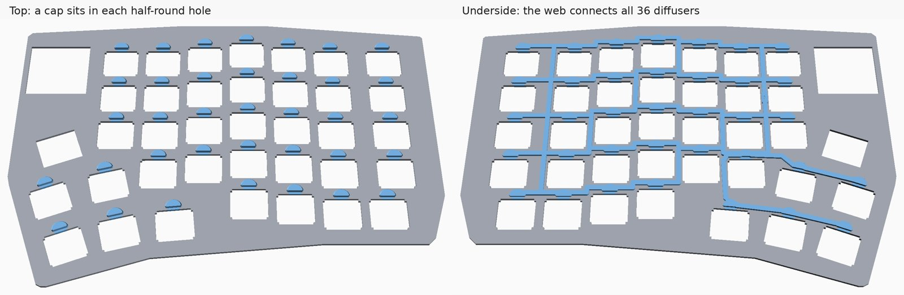

import { Aside } from '@astrojs/starlight/components';

Two parts that are not needed for a working keyboard, but that most builders choose to add. Both
are in the [PolyKybd hardware repo](https://github.com/thpoll83/PolyKybd) under `parts/`.

## Tenting legs

The legs attach under each half and tilt it towards you. Worth printing if you chose the
**stepped** [keycap stem profile](/assembly/keycap-stems/), which is designed around the keyboard
sitting at 5 degrees or more.

| Part | File |
|---|---|
| Legs, 8 per plate | `parts/export/legs/legs_r2_8p.stl` |

One plate is the whole set: **eight legs in four mirrored pairs**, 119 × 39 × 3.8 mm, so a single
print does both halves.

The source is `parts/legs/legs.scad`; re-export it with `parts/build_parts.sh legs`.

## LED diffuser frame

Each key has an LED behind it, shining through a half-round hole in the plate. Left bare, the
light looks like a bright point rather than an even glow. The **diffuser** is a small light pipe
that clips into that hole and spreads it.

The current generation is a **one-piece frame**: all 36 diffusers per half, held at their exact
plate positions and rotations by a web that runs underneath the plate, through the solid material
between the switch openings. So you fit one part per half instead of placing 36 loose pieces.

| Part | File |
|---|---|
| Frame, left half | `parts/export/diffuser/diffuser_frame_left.stl` |
| Frame, right half | `parts/export/diffuser/diffuser_frame_right.stl` |
| Four copies stacked on a sprue | `..._left_4x.stl` / `..._right_4x.stl` |

<Aside type="caution">
Fitting the frame means using a **different spacer**: `parts/export/case/spacer_diffuser_frame.stl`
instead of the plain `spacer.stl`, because the plain one has nowhere for the frame's web to go.
It is notched on **both** faces, so the one part serves either half — see
[Case & Spacer](/assembly/case/).
</Aside>

Print it in resin (SLA). It is a thin, delicate part, and the web is deliberately close to the
minimum wall a print service will accept.

The `_4x` files stack four copies on top of each other, joined by a sprue so that a print service
counts one part. The slicer still needs supports between the copies. Cut the pins off before fitting.

### Fitting the frame

Fit the frame into the plate before anything else is done with the plate, and before the plate goes
onto the spacer. The slide needs the space under the plate.

1. Hold the frame under the plate so that each diffuser goes up through its own switch opening.
2. Slide the frame about 5.5mm, so that each diffuser moves out of the switch opening and into the
   half-round LED hole next to it, until every diffuser sits in its half-round.

The caps on the top and bottom hold the plate between them, and the switches stop the frame from
sliding back once they are in, so no glue is needed.



### Changing the plate

The frame is generated from the plate PCB
(`poly_kybd/poly_kybd_split72_plate_<side>.kicad_pcb`) by `parts/diffuser/gen_diffuser_frame.py`.

So if you change the plate, regenerate it rather than edit the model by hand:

```bash
parts/diffuser/build_frame.sh          # regenerate from the PCB, export, verify
parts/diffuser/build_frame.sh --check  # verify the committed meshes only
```

The verify step runs `parts/diffuser/check_frame.py`, which checks watertightness, minimum wall
thickness, left/right symmetry, the fit in the plate and clearance against the spacer.

### The older diffuser

Earlier builds used 76 loose light pipes (`parts/export/diffuser/diff_v2.stl`), clipped in one at
a time. They still print, but the frame is much easier to fit.
