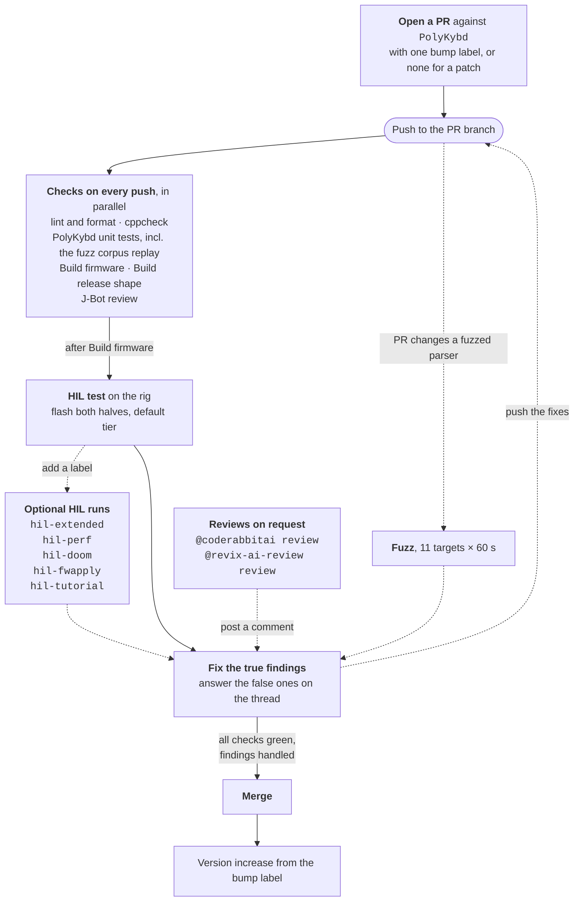

import AiSkill from '../../../components/AiSkill.astro';

PolyKybd is fully open. Contributions are welcome across all repositories.

## Where to contribute

| What | Repository |
|---|---|
| Documentation | [thpoll83/polykybd-docs](https://github.com/thpoll83/polykybd-docs) |
| Hardware (PCB, case, STLs) | [thpoll83/PolyKybd](https://github.com/thpoll83/PolyKybd) |
| QMK firmware | [thpoll83/qmk_firmware](https://github.com/thpoll83/qmk_firmware) — branch `PolyKybd` |
| Host software | [thpoll83/PolyKybdHost](https://github.com/thpoll83/PolyKybdHost) |
| Host app translations | [thpoll83/PolyKybdHost](https://github.com/thpoll83/PolyKybdHost) — one file per language, `polyhost/res/locale/<code>.po`; see [Interface language](/software/usage/#interface-language) |
| Display rendering | [thpoll83/adafruit-gfx-library](https://github.com/thpoll83/adafruit-gfx-library) |
| Test rig / CI | [thpoll83/polykybd-ctnd](https://github.com/thpoll83/polykybd-ctnd) — the [HIL test & deploy station](/development/test-rig/) |

## Contributing to the docs

The docs are plain Markdown / MDX files. To contribute:

1. Fork [thpoll83/polykybd-docs](https://github.com/thpoll83/polykybd-docs)
2. Create a branch for your change
3. Edit or add `.md` / `.mdx` files in `src/content/docs/`
4. Preview locally with `npm run dev`
5. Open a pull request

Common contributions that are always welcome:

- Tested compatible switch additions to the Compatible Switches page
- Corrections to assembly steps
- OS-specific installation notes or troubleshooting tips
- Translations (open an issue first to coordinate)

The documentation is licensed under **CC BY 4.0**. By contributing, you agree that your contribution is made under the same license.

<AiSkill name="update-polykybd-docs">
When you change a user-facing feature in the firmware or host, the
**`update-polykybd-docs`** skill finds the docs pages that a change makes wrong or incomplete and
extends them, so this site stays current with the code. At the end of a long session,
**`session-retro`** scans it for problems found during the session that are worth recording and workflows worth codifying as
new skills.
</AiSkill>

## Contributing to the firmware

See [Firmware Development](/development/firmware/) for setup instructions. For significant changes, open an issue first to discuss the approach.

## From pull request to merge

This is what happens to a firmware pull request on `thpoll83/qmk_firmware`, from opening it
until it is merged. Solid lines run on every PR. Dashed lines run only when the condition on
the line is true.

- **cppcheck and the unit tests** run when the PR changes `keyboards/polykybd/` or
  `modules/polykybd/`.
- **The fuzz jobs** run when the PR changes a parser they test, a header those parsers
  include, a harness under `keyboards/polykybd/dev/fuzz/` or their workflow. They run in
  parallel with the builds. To fuzz longer, start *PolyKybd fuzz* from the Actions tab and
  set the run time per target (up to about 5 h 30 min).
- **Every Wednesday and Sunday at 01:43 UTC** the fuzz workflow runs each target for 5 h
  on `PolyKybd`, continuing from the inputs the previous long run found. A crash opens an
  issue `Fuzz crash: <target>` with the label `fuzz-crash` and a link to the crash input.
- **The HIL test** waits for *Build firmware*, then flashes the build to the test rig. Each
  optional HIL label starts its own run with the slower checks.
- **A push cancels a running CodeRabbit review.** Push the fixes for one review together,
  after it has finished.
- **A merge does not publish a release.** The version increases when the PR merges, and the
  release is published later, see [Releases](#releases).

A host app pull request on `thpoll83/PolyKybdHost` follows the same steps without the rig:
CodeQL, the J-Bot review, and the installer and plugin builds for the files the PR changes.
The unit suite runs locally with `scripts/run_tests.py`.

## Releases

Both the firmware and the host app ship as **GitHub Releases** — a tagged version with
customer-facing release notes, and (for the firmware) CI-built `.bin`/`.uf2` assets. Maintainers
draft the notes newest-version-first, keep them concise, then publish.

<AiSkill name="polykybd-github-release">
**`polykybd-github-release`** drives the whole release — it drafts the
notes, gets your review, then publishes with the right tag, title and assets.
**`polykybd-release-notes`** just writes the changelog for a version range if that's all you need.
</AiSkill>

## Reporting issues

Open an issue on the relevant repository. For hardware/build problems, include:

- Which revision of the PCB and case you are using
- Photos if relevant
- Which step of the build guide the problem occurs at

## Support the project

PolyKybd is an independent project. If you find it useful, consider supporting it financially via [Ko-fi](https://ko-fi.com/polykb).
