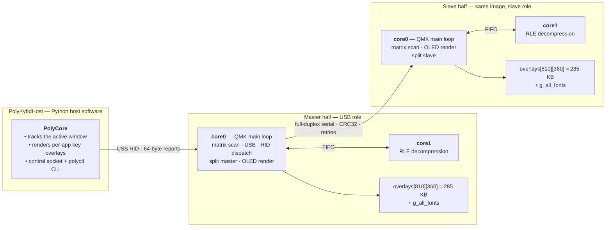
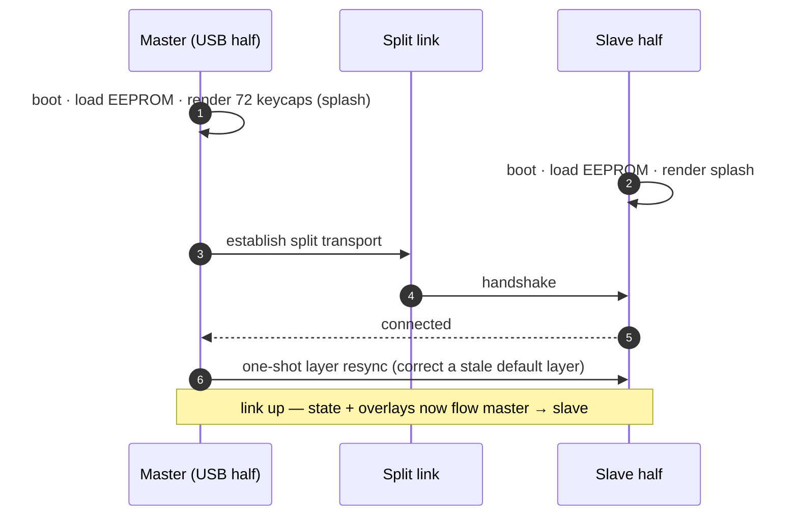
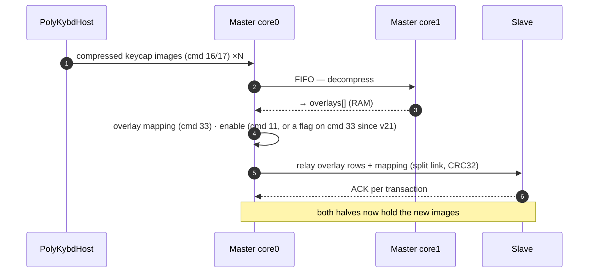
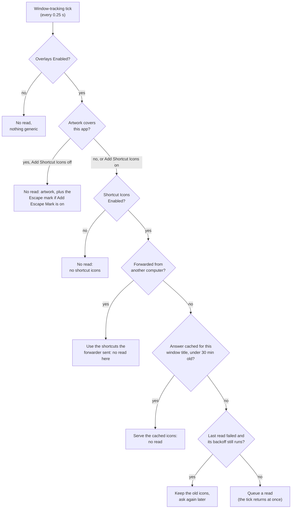
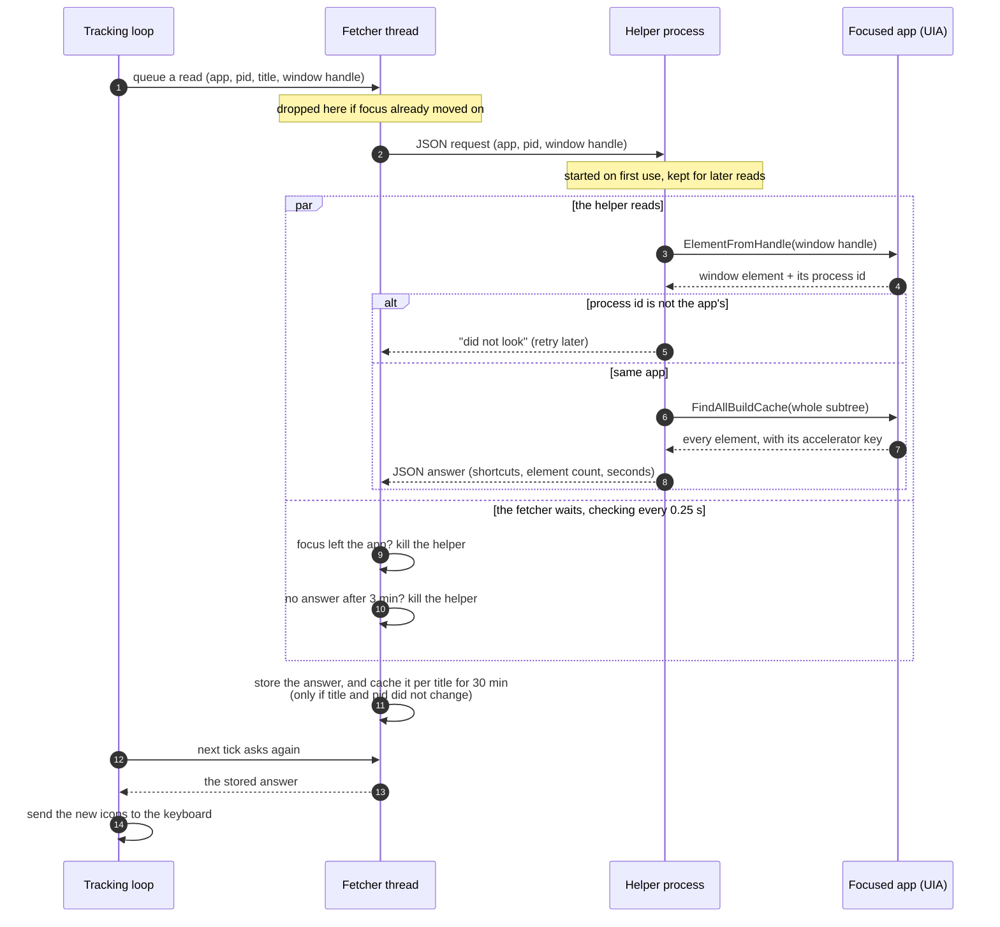
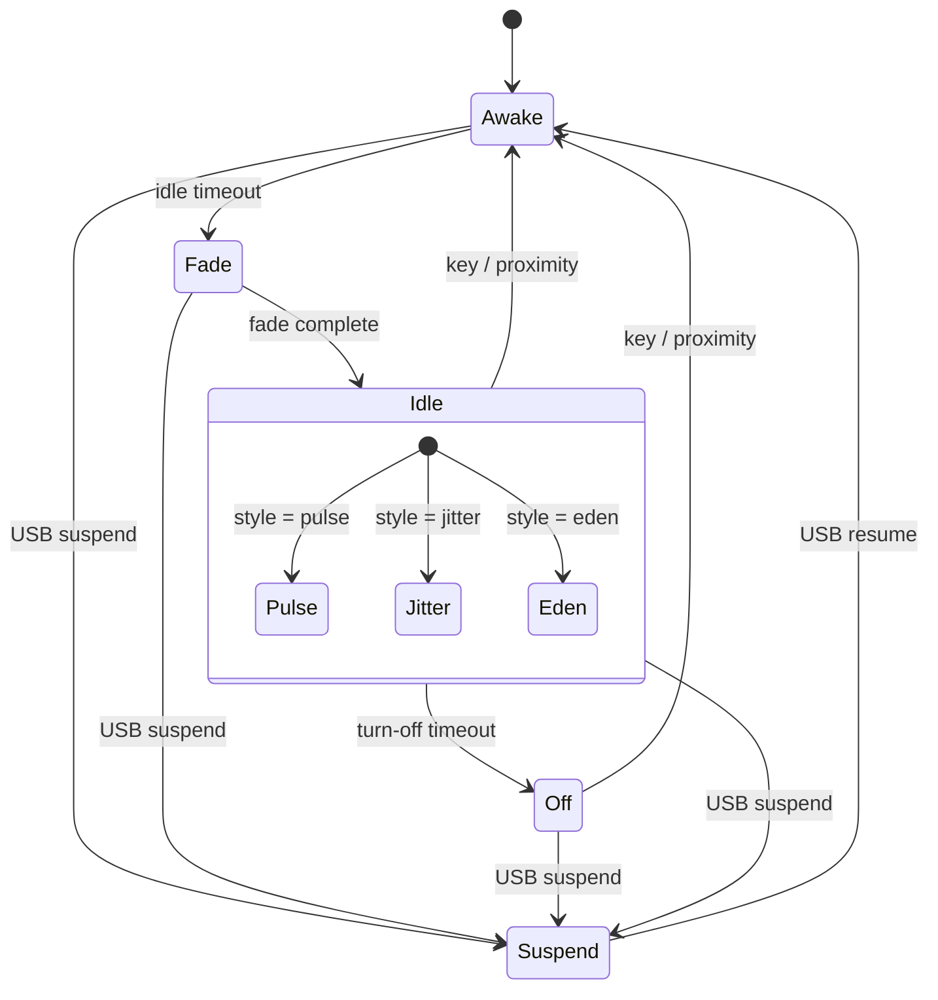
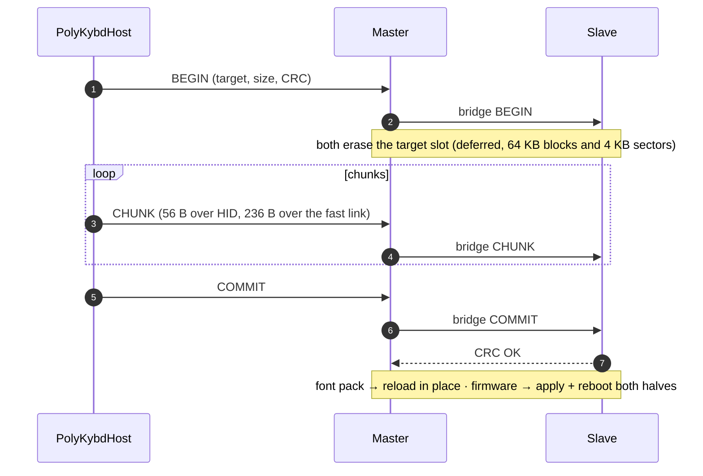

import { Aside } from '@astrojs/starlight/components';

PolyKybd has many components: a host application (**PolyKybdHost**), two keyboard halves that
run the **same** firmware image in different roles, a custom HID protocol, and 8 MB
of external flash divided into regions. This page shows how it
all fits together — the topology, the command set, where resources live, and the
handful of runtime processes worth understanding before you change any of them.

## Topology — who talks to whom

Three actors, two links. **PolyKybdHost** only ever speaks to the **master** (the USB half).
The master owns the HID device and is the only one that relays to the **slave** over
the split serial link. Both halves run the identical firmware — including a second
core (`core1`) used to offload RLE decompression — and differ only in role, decided
at runtime from which half has USB.

<Aside type="note">
The slave **never communicates with PolyKybdHost**. Everything it displays was relayed by the
master over the split link. Each half keeps its **own** copy of the overlay images in
RAM, which is why an image change has to be sent to both halves.
</Aside>

## The HID command set

Every report is `[report-id][command][payload…]`, 64 bytes. Replies are prefixed
`P\xNN.` (ACK) or `P\xNN!` (NACK). Commands live on the keyboard-specific
`ID_POLYKYBD = 80` channel. Newer commands are gated by `PROTOCOL_VERSION`, but the host
does **not** require an exact match — it connects to any firmware reporting protocol **2 or
newer** (the floor at which it can still enumerate languages) and then enables each feature
individually:

| Keyboard vs host protocol | What happens |
|---|---|
| Below the floor | Refused — *"please update the keyboard firmware"* |
| Older than the host | Connects; features the firmware lacks are greyed out |
| Same as the host | Fully supported |
| Newer than the host | Connects in a restricted **safe mode**, and offers to update the host app |

So a keyboard and a host app from different releases still work together, with only the
newer features unavailable — rather than refusing to connect at all.

### Overlays — the bulk data path

| Cmd | Name | Notes |
|----|------|-------|
| `10` / `0x0A` | SEND_OVERLAY | Plain 60-byte segment (6 per keycap). |
| `16` / `17` | START / SEND_COMPRESSED_OVERLAY | RLE-compressed keycap in 1–2 packets → `core1` decompress. The common case. |
| `18` / `19` | START / SEND_ROI_OVERLAY | Partial refresh of a keycap region. |
| `41` / `0x29` | SEND_PRC_OVERLAY | **v19+.** [PRC](/reference/hid-protocol/#prc-predictive-range-coding)-coded keycaps, several per report; decoded on `core0`. |
| `21` / `0x15` | SEND_OVERLAY_MAPPING | pool→display map: which slot each keycap draws. |
| `33` / `0x21` | SEND_OVERLAY_MAPPING_W | **v12+.** The same map with a variable value width; **v21+** its width byte also carries the prepare / enable [flags](/reference/hid-protocol/#mapping-flags), and **v23+** a dim flag. |
| `11` / `12` | OVERLAY_FLAGS on / off | Enable/disable overlay rendering. |
| `26` / `0x1A` | SAVE_MRU | Persist the keyboard's most-recently-used emoji / language picks. |

### Identity & language

| Cmd | Name | Notes |
|----|------|-------|
| `6` | GET_ID | id string + per-bundle font-pack version block (after the NUL). The connect handshake. |
| `7` | GET_LANG | Current language code. |
| `27` / `0x1B` | GET_LANG_LIST_PACKED | Language list as 2-byte ISO index pairs. |
| `9` | CHANGE_LANG | Select active language. |
| `22` | GET_DEFAULT_LAYER | Read the persisted default layer. |

### Configuration & display

| Cmd | Name | Notes |
|----|------|-------|
| `13` | SET_BRIGHTNESS | Contrast; a flags byte selects volatile / host-auto. |
| `14` | KEYPRESS | Host-injected key event. |
| `15` | IDLE_STATE | Start / stop the idle anti-burn-in animation. |
| `20` | SET_UNICODE_MODE | Linux / Mac / Windows / WinCompose / BSD input mode. |
| `24` | DISPLAY_OFF | Blank the keycaps. |
| `28` / `0x1C` | IDLE_STYLE | Idle anti-burn-in style: pulse / jitter / screensaver. |
| `29` / `0x1D` | SET_OS | Active host OS → modifier legends. |
| `30` / `0x1E` | GLYPH_SCRIPT | Override legends with a fantasy/retro script (open-ended index). |
| `23` / `25` | BOOTLOADER / HANDEDNESS | Enter bootloader; set which half is which. |

### Resource flash transport — BEGIN / CHUNK / COMMIT

| Cmd | Name | Notes |
|----|------|-------|
| `0x50` | FONTPACK_BEGIN | Erase the target slot; a byte selects the target (font bundle, firmware, engine data). |
| `0x51` | FONTPACK_CHUNK | 56-byte sequential chunks; deferred erase; bridged to the slave. Firmware images take their chunks over the fast link instead when the host has it ([Firmware Update](/beyond-qmk/firmware-update/#the-fast-link)). |
| `0x52` | FONTPACK_COMMIT | Verify CRC32, mark the slot present. |

The same three-command flow, with a different target, drives **firmware update**,
**font-pack bundles**, and the **engine packs** — see [Resource flashing](#resource-flashing-firmware--font-packs) below.

## Where resources live — the 8 MB flash

Custom hardware: 8 MB external QSPI, divided into fixed partitions. The authoritative map is
`base/fw_staging.h`.

| Range | Size | Contents |
|-------|------|----------|
| `0x000000–0x200000` | 2 MB | Running firmware (linker `flash1` XIP window) |
| `0x200000–0x400000` | 2 MB | Firmware-update staging (4 KB header + staged image) |
| `0x400000–0x600000` | 2 MB | Font pack — independently-versioned bundles, each in its own slot |
| `0x600000–0x7C0000` | 1.75 MB | DOOM WAD (pinned to the engine's XIP address) |
| `0x7C0000–0x7FE000` | 248 KB | DOOM engine pack |
| `0x7FE000–0x800000` | 8 KB | Emulated EEPROM (wear-levelling backing store) |

The firmware cannot use the last 8 KB: QMK's RP2040 wear-levelling driver
places the emulated EEPROM at the very top of flash, so everything you configure —
keymap, brightness, language, idle style, glyph script — lives there, and the DOOM
engine-pack slot deliberately stops short of it.

The **firmware partition** is the budget that matters for adding languages and fonts:
`split72:default` uses roughly a third of its 2 MB. `FW_STAGING_OFFSET` is kept equal
to the linker's `flash1` length, so a build that exceeds 2 MB fails to **link** rather
than overwriting the staging area without an error.

Font-pack bundles are **`.plyf`** files carrying **ABI version 2** — column-native
(OLED page) glyph bitmaps (see [Column-native glyph bitmap format](/development/display-graphics/#column-native-glyph-bitmap-format)). A keyboard rejects a bundle whose ABI does not match its firmware and falls back to its resident fonts, so the host, firmware, and shipped bundles are versioned together.

### The RAM working set

| | |
|---|---|
| `overlay_pool[600][360]` | ≈ 211 KiB — the live keycap images, addressed indirectly so variants sharing artwork share a slot |
| `display_to_pool[1440]` | display position → pool slot (90 slots × 16 modifier variants) |
| display position | `slot + 90 × modifier_variant`; since v12 the variant is the modifier bitmask (Ctrl/Shift/Alt/GUI), so all 16 combinations are addressable |
| `g_all_fonts` | resident fonts ++ the flashed font-pack bundles, assembled at boot |

## Runtime processes

### Boot & split-link establishment

Each half boots independently and loads its own state from EEPROM. The USB half
becomes the master; it renders all keycaps and brings up the split link to the slave.
Until the link establishes, the master retries; if it never comes up, the master runs alone.

<Aside type="note">
There is a brief **boot-time busy window** on the master (the initial 72-keycap
render plus the first sync to a slave that may still be coming up). It clears within a
couple of seconds; a person never notices it, but automated tooling that sends commands to the
keyboard immediately after power-on can.
</Aside>

### Overlay data path — an app switch

When the active window changes, PolyKybdHost sends the new keycap images. The master
decompresses them (on `core1`) into its overlay RAM, then relays each keycap to the
slave over the split link so both halves show the same thing.

Frequently-used apps are also cached (the MRU path), so a return to a recent app
replays from cache rather than re-sending every image.

### Shortcut icons on Windows — the UI Automation read

For an app without hand-made artwork, PolyKybdHost reads the app's own shortcuts and
draws an icon for each one it recognises (see [Generic Overlays](/using/generic-overlays/)).
On Windows the read goes through UI Automation, which walks every element of the
window. On a long browser page that is tens of thousands of elements and can take
minutes. So the read never runs in the window-tracking loop. The loop only asks for
an answer, and a separate helper process does the walk.

The first question, asked every 0.25 s, is whether a read should start at all:

The read itself runs on a worker thread in PolyKybdHost, which hands it to the helper
process over its standard input and output:

Three things follow from this layout:

- A slow read runs in the helper process, not in PolyKybdHost. The tracking loop, the
  tray menu and the brightness requests keep their normal speed.
- A read reports on the window the loop matched. The helper starts from that window's
  handle and refuses a window owned by another process, so a slow read cannot store one
  app's shortcuts under another app. If the handle cannot be read, the helper starts from
  the focused element and still checks the process. If the process id cannot be read,
  there is nothing to check against.
- Killing the helper is the only way to stop a read midway. It is restarted on the next
  read. Linux (AT-SPI) and macOS (the menu bar) read inside PolyKybdHost; their reads
  are capped at 4000 and 3000 elements.

This describes the PolyKybdHost release that includes the helper process.

### Display power states

To avoid burning the OLED legends in, the keycaps fade and then run the configured
[idle style](/using/idle/) — pulsing, migrating their legends, or a full screensaver —
and turn off entirely after a longer timeout. Any key activity (or proximity, if the
light sensor is fitted) wakes them.

Only the **style value** crosses the split link; each half runs its own idle animation
on its own keys from that and the shared pulse value. The Eden screensaver is drawn by
split72-only code, so selecting it on a split42 leaves the legends dimmed and static —
see [Idle & Burn-in Protection](/using/idle/).

### Resource flashing (firmware & font packs)

Firmware images, font-pack bundles, and the engine packs all use the same BEGIN / CHUNK
/ COMMIT transport. The master streams chunks to its own staging flash **and** bridges
them to the slave, so both halves end up with byte-identical data. A firmware apply
reboots both halves at the same time.

<Aside type="caution">
Slow work never runs inside a split-transaction handler. A font-pack COMMIT verifies
the whole pack, which is too slow for the transaction window, so the slave ACKs on the
fast transport CRC and defers the full reload to its main loop.
</Aside>

### Multicore: what runs on core1

The RP2040 has two cores. QMK runs on `core0`. `core1` runs a small service loop with no
RTOS thread, no console and interrupts masked: `core0` hands it jobs over the inter-core
FIFO, and it decompresses overlay images, renders the Eden screensaver (from firmware
1.5.0) and runs DOOM.
How it is started, who owns it when, and how to add a job of your own are on
[The Second Core](/beyond-qmk/core1/).

## Where to go next

- [Firmware Development](/development/firmware/) — build the firmware and set up the toolchain.
- [HID Protocol](/reference/hid-protocol/) — the full command reference.
- [Display Graphics & Fonts](/development/display-graphics/) — how keycap images and fonts are generated.
- [What PolyKybd Adds to QMK](/beyond-qmk/overview/) — firmware update, signing, the crash handler, core1 and the other features stock QMK does not have.
