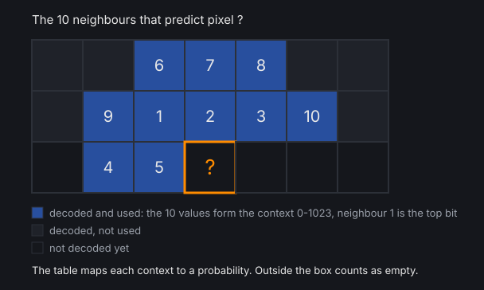
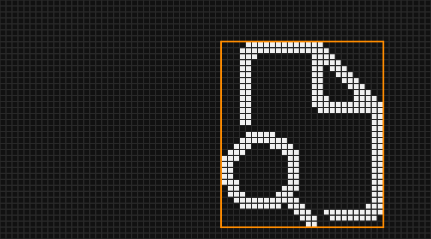

import { Aside } from '@astrojs/starlight/components';

This page is part of the [HID Protocol Reference](/reference/hid-protocol/).

## RLE overlay encoding

The compressed uploads (`0x10`/`0x11`, and `0x12`/`0x13` with the RLE bit) use a bit-run
encoding: each byte describes one run of identical pixels.

- **Input**: the image read as a bit stream, most significant bit of each byte first. For
  a whole keycap that is all 2880 pixels; for an ROI, the rectangle's pixels.
- **One byte per run.** Bit 7 is the pixel value of the run, bits 0–6 its length,
  `0..127`. A run longer than 127 is split: 300 lit pixels are `FF FF AE`.
- **The stream starts with a run of unlit pixels.** An image whose first pixel is lit
  begins with `00`, an empty run.
- **Empty runs decode to nothing.** That is why the zero fill after the last data byte of
  the final report needs no length field: every `00` is a run of no pixels.

Example, 16 pixels `0000 0111 1111 1000`: 5 unlit, 8 lit, 3 unlit, coded as `05 88 03`.

The firmware decoder is `rle_decompress()` in the
[`polymod_rle`](/beyond-qmk/community-modules/) module. It takes the bit position to
continue from, so each report is decoded on arrival without buffering the whole stream,
and it stops at the end of the 360-byte image whatever the stream says. For a whole
keycap it runs on [core1](/beyond-qmk/core1/) where available. For an ROI, the firmware
decodes one run byte at a time (at most 127 pixels) and places the pixels into the
rectangle row by row.

The host encoder is `polyhost/util/rle_util.py`. RLE saves space on large uniform areas and
uses more space on detailed or dithered images, where runs are 1–2 pixels and each costs a byte
that plain data would spread over 8 pixels. The host therefore sizes each image in every
encoding (plain, RLE, ROI, ROI with RLE, and [PRC](#prc-predictive-range-coding) from
v19) and sends the one that needs the fewest reports.

## PRC: Predictive Range Coding

Since **v19** the host has a fifth encoding for keycap images: **PRC**, short for
*Predictive Range Coding*. Host and firmware must both be on v19 or later; with an older
keyboard the host keeps using the four older encodings.

PRC is a context-model binary arithmetic coder, the scheme of [JBIG](https://en.wikipedia.org/wiki/JBIG), the fax-image standard [ITU-T T.82](https://www.itu.int/rec/T-REC-T.82):

- **Context model.** Before a pixel is decoded, 10 already-decoded pixels in a fixed causal
  template (3 pixels two rows up, 5 one row up, 2 to the left in the same row) form a
  10-bit context, 0–1023. A fixed
  1 KB table maps each context to P(pixel is clear). Keycap icons are mostly clear area and
  clean stroke edges, so for most pixels the table's prediction is near 0% or 100%.
- **Range coding.** A binary range coder turns those probabilities into bits. A pixel's code
  length is its information content, −log₂ p, where p is the probability the table gave its
  actual value: a correctly predicted pixel costs a fraction of a bit, a mispredicted one
  several bits. The table was trained once on the shipped overlay templates and is compiled
  into the firmware.

**Where the template comes from.** Three decisions shape it, and only one of them was
trained:

- **Which 10 pixels: taken from JBIG unchanged, not measured.** PRC uses the pixel pattern
  of JBIG's three-line template, defined in [ITU-T T.82](https://www.itu.int/rec/T-REC-T.82).
  JBIG lets the encoder move one of the five pixels in the row above, the adaptive pixel;
  PRC keeps it at its default place, two columns right. No other set of positions was
  compared on the keycap icons.
- **The numbering 1–10: our own convention, not JBIG's.** It sets which neighbour is the context's most
  significant bit: the five nearest first, then the five farther ones. Any order gives the
  same compression, because reordering the bits only relabels the 1,024 contexts. Each
  context still collects the same pixels during training, so every probability and every
  code length stays the same. The order is fixed only because host and firmware must agree
  on it.
- **The table: trained.** For each of the 1,024 contexts, the training counted how often the
  pixel is clear across the shipped overlay templates. This is the only part that comes from
  the data.

Only the bounding box (ROI) of the set pixels is coded. A typical icon's coded payload is about
28 bytes, against about 87 for the best of the older encodings. Each record adds a 6-byte header,
and a report carries 62 bytes after its `P` and command byte. So most icons need one report, and
two records share one when together they fit in 62 bytes. Across the 118 shipped templates, the image reports of an uncached app
switch fall to 40% (4348 → 1753); a JetBrains IDE goes from 205 to 81.

The host decides per image: an image goes out as PRC only if its record fits one report, which
is never more reports than an older encoding would take. Larger images use the older encodings.

### Worked example: a 10 × 10 square

Take a solid 10 × 10 square: a 100-pixel ROI with every pixel set. Uncoded, it takes 100 bits
(13 bytes). The coder visits the pixels in raster order. Context pixels outside the ROI count
as clear.

| Pixel (row, column) | Context | P(set) from the table | Code length |
|---|---|---|---|
| (0, 0), first pixel | all 10 outside the ROI, so all clear | 1.6% | 6.0 bits |
| (0, 1) | left neighbour set | 86% | 0.21 bits |
| (1, 0) | row above set, left neighbours clear | 80% | 0.31 bits |
| (1, 5) | row above and left neighbours set | 99.6% | 0.006 bits |
| (5, 5) | all 10 set | 95% | 0.075 bits |
| (9, 9), last pixel | set, but the upper-right context pixels lie outside the ROI | 80% | 0.32 bits |

The figure shows the code length of all 100 pixels. The colour scale runs from dark blue
(predicted, near zero bits) to red (mispredicted):

Only the first pixel is mispredicted. Every later pixel matches the prediction, so the 100
pixels together carry 19.2 bits of information. The coder's initial and flush bytes bring the
payload to **6 bytes**, and the record to 12.

The table was trained on real icons, which are mostly 1–2 px strokes. So a pixel whose whole
context is set (95%) is predicted less confidently than one continuing a stroke edge (99.6%):
large filled areas are rare in the training set.

### Worked example: a real icon

VS Code's `Ctrl+P` (*Quick Open*) shows the Fluent *Document Search* icon. Its set pixels fit a
27 × 31 px ROI (orange) in the right half of the 72 × 40 px keycap, rows 7–37 and columns 37–63:

| Encoding | Bytes | Reports |
|---|---|---|
| Plain (`0x0A`) | 360 | 5 (all-clear segments are skipped) |
| RLE, whole keycap (`0x10`/`0x11`) | 154 | 3 |
| ROI, uncompressed (`0x12`/`0x13`) | 105 | 2 |
| ROI, RLE (`0x12`/`0x13`) | 139 | 3 |
| **PRC** (`0x29`) | **26 + 6-byte header** | **1, with 30 bytes left** |

The best older encoding needs 2 reports. The PRC record is 32 bytes, which leaves 30 of the
report's 62 bytes. The next record joins it if its whole record, header included, fits in those
30 bytes; otherwise it starts a new report.

The next figure shows where the 26 bytes go. It colours each of the ROI's 837 pixels by its code
length, on the same scale as the square; set pixels have a white outline:

- **A** is set where the table gave P(set) = 1.6%: the page's bottom edge resumes after the gap
  for the magnifier's handle, and no context pixel indicates it. 6 bits, the same as the
  square's first pixel.
- **B** is clear where the table gave P(set) = 94.9%: the context matches a continuing stroke,
  but the handle ends there. 4.3 bits.
- **C** lies inside the page's right edge. The context is unambiguous, P(set) = 99.2%, and the
  pixel costs 0.01 bits.

Most of the ROI behaves like C. 610 of the 837 pixels (73%) cost under 0.1 bit each, 18 bits
in total. 43 pixels (5%), the stroke starts, ends and corners, carry 61% of the 185.6 bits.
That is why PRC saves the most on line icons: long strokes, few stroke ends.

### One row, pixel by pixel

The coder handles the ROI one row at a time, left to right. Row 2 of the ROI (keycap row 9)
is the page's top edge below the folded corner. Rows 0 and 1 above it are already decoded:

Column 4 shows how a context is formed. Its 10 neighbours, in template order, read
1 1 1 0 1 0 1 1 0 1. Neighbour 1 is the most significant bit, so the context is
`1110101101` in binary, 941. Table v1 holds 2 at index 941: P(clear) = 2/256, so
P(set) = 99.2%. The pixel is set and costs −log₂ 0.992 = 0.011 bits.

The whole row, with runs of identical context and value merged into one line:

{/* generated by PolyKybdHost tools/prc_doc_figures.py --row-table: ROI row 2, keycap row 9 */}
| Column | Pixel | Context bits 1–10 | Context | Table byte | P(set) | Code length | Running total |
|---|---|---|---|---|---|---|---|
| 0 | clear | `0000000000` | 0 | 252 | 1.6% | 0.023 | 0.02 |
| 1 | clear | `0000000001` | 1 | 243 | 5.1% | 0.075 | 0.10 |
| 2 | clear | `0010000001` | 129 | 97 | 62.1% | 1.400 | 1.50 |
| 3 | set | `0110000101` | 389 | 31 | 87.9% | 0.186 | 1.68 |
| 4 | set | `1110101101` | 941 | 2 | 99.2% | 0.011 | 1.70 |
| 5 | set | `1111111111` | 1023 | 13 | 94.9% | 0.075 | 1.77 |
| 6 | clear | `1111111111` | 1023 | 13 | 94.9% | 4.300 | 6.07 |
| 7 | clear | `1111011111` | 991 | 229 | 10.5% | 0.161 | 6.23 |
| 8–14 | clear | `1110011111` | 927 | 234 | 8.6% | 0.130 each | 7.14 |
| 15 | set | `1110011111` | 927 | 234 | 8.6% | 3.541 | 10.68 |
| 16 | set | `1110111010` | 954 | 1 | 99.6% | 0.006 | 10.68 |
| 17 | set | `1101110010` | 882 | 17 | 93.4% | 0.099 | 10.78 |
| 18 | set | `1001100010` | 610 | 73 | 71.5% | 0.484 | 11.27 |
| 19 | clear | `0001100010` | 98 | 185 | 27.7% | 0.469 | 11.74 |
| 20 | clear | `0001000000` | 64 | 254 | 0.8% | 0.011 | 11.75 |
| 21–26 | clear | `0000000000` | 0 | 252 | 1.6% | 0.023 each | 11.88 |

Read from left to right:

- **Columns 0–1** are clear. At most one context pixel is set (neighbour 10 of column 1),
  so P(set) is 1.6–5.1% and each pixel costs under 0.1 bit.
- **Column 2** is clear, but neighbours 3 and 10 are set: the page's top edge starts above
  and to the right. The table gives P(set) = 62.1%, and the pixel costs 1.4 bits.
- **Columns 3–5** are the page's left edge, predicted at 87.9–99.2%: 0.01–0.19 bits each.
- **Column 6** has all 10 neighbours set and P(set) = 94.9%, but it is clear: the page's
  interior starts here. 4.3 bits, more than a third of the row.
- **Columns 7–14** are the page's interior below the set top edge. The table gives
  P(set) = 8.6–10.5% here, against 1.6% in open space, so these clear pixels cost
  0.13–0.16 bits each.
- **Column 15** has the same context as columns 8–14, but it is set: the fold's diagonal
  starts. 3.5 bits.
- **Columns 16–18** continue the diagonal, predicted at 71.5–99.6%.
- **Columns 19–26** lie right of the fold and are clear: 0.01–0.47 bits each.

The 27 pixels carry 11.9 bits of information; uncoded they take 27. The three mispredicted
pixels, columns 2, 6 and 15, carry 9.2 of those 11.9 bits. The range coder emits no bits per
pixel: it narrows one interval by each pixel's probability, so the payload follows the sum
over the whole ROI. For this icon that is 185.6 bits, which the coder writes as 26 bytes,
including its start and flush overhead.

**Report layout.** After `P` and `0x29`, the report carries records one after another. A keycode byte
of 0 (the zero padding) ends the list.

| Field | Bits | Content |
|---|---|---|
| keycode | 8 | Addresses the image like the other upload commands |
| modifier | 4 | Modifier variant 0–15 |
| top, left | 6, 7 | Top-left corner of the ROI |
| height − 1, width − 1 | 6, 7 | ROI size |
| length | 6 | Payload bytes that follow |
| reserved | 4 | Must be 0 |
| payload | length × 8 | The range-coded ROI |

<Aside type="caution">
The table is part of the format. Host and keyboard must use the identical 1 KB table, or the
keycaps show corrupted images and nothing reports an error. A retrained table would be a new protocol
version, never a change to table v1.
</Aside>
