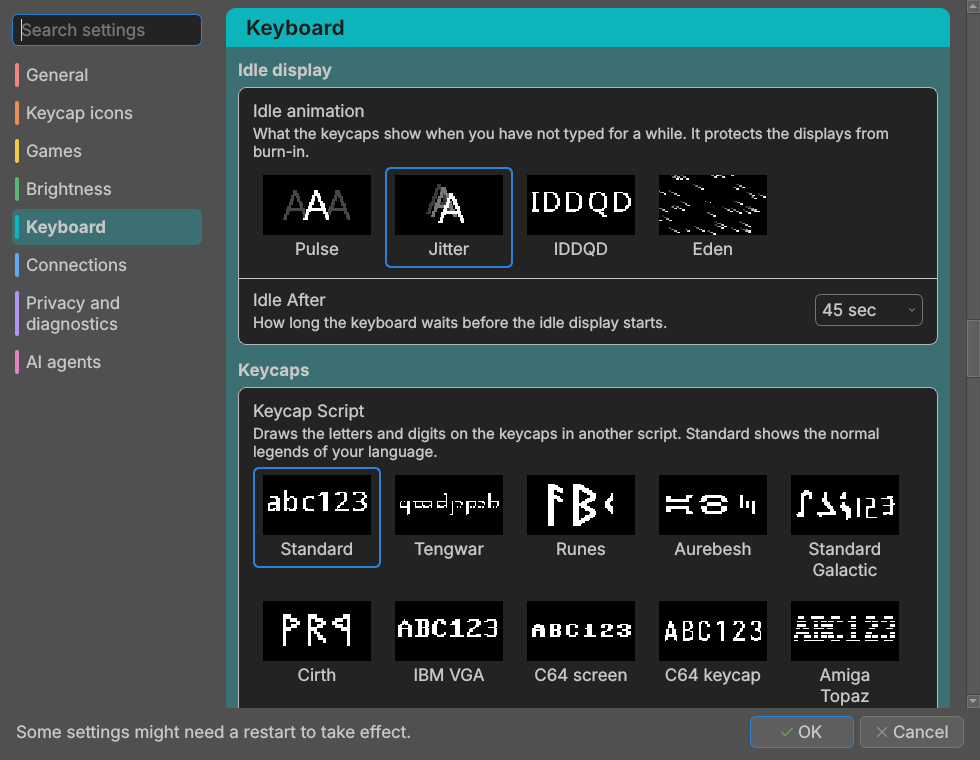

import { Aside } from '@astrojs/starlight/components';
import SupportedSince from '../../../components/SupportedSince.astro';

<SupportedSince label="Host 1.21.7+" title="The PolyKybdHost version this page describes" />

Open **Settings…** in the tray menu. The list on the left has the sections of this page;
choose one to jump to it. From host 1.28.2 each section has a colour: the band behind its
title, a light tint behind its settings, and the stripe of its entry in the list. Each setting shows its description under its name. The search
field above the list shows only the settings with a word that starts with what you type,
in the name or the description: `port` finds **Receiver port**, but not *transport*.

From host 1.28.9 the sections are in this order: General, Brightness, Keyboard,
Connections, Keycap icons, AI agents, Games, Privacy and diagnostics, Developer. Settings
that most people never change are hidden until you turn on the **Advanced** switch in the
section's title band. The tables below mark them *(Advanced)*. A search finds them with the
switch off too. The switch stays as you set it until the tray app restarts.

A number or a list in the dialog changes with the mouse wheel only after you click it.
Otherwise the wheel scrolls the page.

From the command line, read or change a setting by its key:

```sh
polyctl settings get problem_scan_level
polyctl settings set ui_theme dark
```

In the tables, the **Dialog** column gives the subheading and the name, when the section
has a subheading.

## General

| Dialog | Key | Default | What it changes |
| --- | --- | --- | --- |
| **Theme** | `ui_theme` | `auto` | The tray menu and dialogs: *Automatic* follows the desktop's light or dark setting, *Light* and *Dark* always use that theme. A desktop that does not report its setting gets the dark theme. |
| **Language** | `ui_language` | `auto` | The language of the menus and dialogs. Applies when the tray app restarts. See [Interface language](/software/usage/#interface-language). |
| **Background service** | `daemon_mode` | on | Runs the keyboard connection in a background service that the tray app connects to. See [Daemon & Client Model](/software/architecture/). |
| **Developer mode** | `developer_mode` | off | Shows the [developer settings](#developer) in this dialog at once, and the [Developer submenu](/software/usage/#developer-mode) in the tray menu after a restart. |

## Brightness

From host 1.28.9 the section starts with **Keycap brightness**: pictures for
**Automatic**, **Off**, **1%**, **50%** and **100%**. It is not a setting with a key: the
choice is sent to the keyboard when you click **OK** (like `polyctl brightness`), and
the keyboard does not report its level, so no picture is selected when the dialog
opens. See [Display Brightness](/using/brightness/).

| Dialog | Key | Default | What it changes |
| --- | --- | --- | --- |
| **Follow daylight** | `brightness_set_daylight_dependent` | on | [Adaptive brightness](/using/brightness/#adaptive-daylight): the host sets the keycap brightness from the sunlight at your location, every ten minutes. |
| **Online location lookup** | `brightness_allow_online_location_lookup` | on | Looks up your approximate location from your IP address (`ip-api.com`), once per run. Off, or with no answer, the brightness follows the hour of the day instead. |
| **Online sunlight data** | `brightness_allow_online_irradiance_request` | on | Asks `open-meteo.com` for the sunlight at that location this hour, which includes cloud cover. Off, the host computes a cloudless-sky value from the location and time. |
| **Daylight curve → Sunlight at dimmest** / **Sunlight at brightest** *(Advanced)* | `irradiance_min` / `irradiance_max` | `1.8` / `5.2` | The sunlight values that map to the dimmest and the brightest level. Lower *Sunlight at brightest* to reach full brightness on a cloudy day. |
| **Daylight curve → Sunlight scale** *(Advanced)* | `irradiance_prescaler` | `0.75` | Multiplies the sunlight value before the two values above apply. |
| **Daylight curve → Curve gamma** *(Advanced)* | `brightness_gamma` | `1.0` | Shapes the daylight curve between dimmest and brightest. Above 1 the middle of the day gets dimmer; below 1 it gets brighter. The end points do not move. |

A change to any of these is applied immediately, without waiting for the next ten-minute
refresh.

## Keyboard

Called *Keyboard data* before host 1.28.2. From host 1.28.2 the section starts with the
settings that the keyboard itself stores. They have no key in `settings.yaml`: the dialog
reads them from the keyboard when it opens and sends a changed value when you click **OK**.
A row stays greyed out until the keyboard answers, and stays greyed out when the keyboard's
firmware does not have that setting. Before 1.28.2 they were in the tray menu.



| Dialog | Command line | What it changes |
| --- | --- | --- |
| **Idle display → Idle animation** | `polyctl idle-style` | What the keycaps show while you are away. See [Idle & Burn-in Protection](/using/idle/). |
| **Idle display → Idle After** | `polyctl idle-timeout` | How long the keyboard waits before the idle animation starts. |
| **Keycaps → Keycap Script** | `polyctl glyph-script` | The script of the letter and digit legends. See [Glyph Scripts](/using/glyph-scripts/). |
| **Keycaps → Script placement** *(Advanced)* | `polyctl glyph-script --placement` | Centred, or in the top-left corner beside an app icon. |
| **Keycaps → Keycap Size** | `polyctl glyph-size` | How large a key's main legend is drawn. See [Legend Size](/using/legend-size/). |
| **Tap-Hold Timing → Tapping term, Flow Tap term** (Flow Tap term: *Advanced*) | `polyctl tap-terms` | The times of dual-function keys. See [Tap-hold timing](/using/keymap-editor/#tap-hold-timing). |
| **Tap-Hold Timing → Auto Shift, Auto Shift timeout** (timeout: *Advanced*) | `polyctl tap-terms --auto-shift` | Hold a key to type its shifted character. See [Auto Shift](/using/keymap-editor/#auto-shift). |

The settings of the host:

| Dialog | Key | Default | What it changes |
| --- | --- | --- | --- |
| **Unicode input → Send Unicode input mode** | `unicode_send_composition_mode` | on | Tells the keyboard how this computer takes Unicode input (for example [WinCompose](/setup/wincompose/) or the native method), on connect and whenever it changes. Off, the keyboard keeps the mode it has stored. |
| **Font packs → Send font packs on connect** (*Update on connect*) | `fontpack_auto_flash` | on | Sends the keyboard the [font packs](/firmware/font-packs/) it is missing or has in an older version, when it connects. Off, you update them yourself from **Updates → Keyboard fonts** or with `polyctl fontpack sync`. |
| **Font packs → Font pack file** *(Advanced)* | `fontpack_path` | empty | A `.plyf` file to flash instead of the pack that ships with the app. Empty uses the shipped pack. |
| **Emoji search → Search language** | `emoji_search_dict` | `en` | The language the keyboard's [emoji search](/using/emoji-search/) uses. |
| **Emoji search → Own dictionary file** *(Advanced)* | `emoji_search_dict_file` | empty | A dictionary you built yourself (`.plyd`), used instead of *Search language*. |

## Connections

| Dialog | Key | Default | What it changes |
| --- | --- | --- | --- |
| **Browser extension → Receive browser reports** | `browser_report_local_enabled` | on | The receiver the browser extension reports to. It listens on `127.0.0.1` only. |
| **Browser extension → Receiver port** *(Advanced)* | `browser_report_port` | `50164` | The receiver's port. It must match the extension's *Host port*. |
| **Browser extension → Receiver token** *(Advanced)* | `browser_report_token` | empty | A shared secret. When set, the extension must send the same token. From 1.23.3, **Generate** fills in a new one and copies it. |
| **Forwarders → Accept forwarders** | `window_report_network_enabled` | off | Accepts window reports from a forwarder on another computer. Applies after a restart. See [Multi-Machine Setup](/using/multi-machine/). |

**USB transport → ID requests before reconnect**, **Messages before a pause** and
**Pause length (s)** (`hid_reconnect_retries`, `max_hid_message_before_delay`,
`delay_time_after_max_hid_messages`) tune the USB connection. Leave them at their defaults
unless you are asked to change them while reporting a problem. All three are *Advanced*.

## Keycap icons

An overlay is a set of icons for one app. **Help & About → Basics** (host 1.28.9) shows an
example. The names below are those of host 1.28.12; older hosts use the names in brackets.


| Dialog | Key | Default | What it changes |
| --- | --- | --- | --- |
| **Icons for apps without an overlay** (*Generic icons*) | `generic_overlays_enabled` | on | [Icons for apps with no overlay](/using/generic-overlays/): the app's logo on Escape and an icon per shortcut. |
| **Read shortcuts from app menus** (*Shortcut icons*) | `shortcut_icons_enabled` | on | The main switch for shortcut icons: an app without its own overlay also gets icons on its shortcut keys, when its menus can be read through the accessibility interface of the operating system. The reading runs in the background, one app at a time, and stops after 3 minutes on Windows, and after 4,000 parts of the app's window on Linux (3,000 on macOS). The shortcuts stay on this computer. Off: no app's menus are read, and an app with its own overlay still shows it. |
| **Download icons from the internet** (*Download missing icons*) | `shortcut_icon_auto_fetch` | on | Downloads app logos and shortcut icons that this computer does not have yet, from simple-icons and Iconify. They are stored on this computer. Off: icons already downloaded keep working. |
| **Match the website in the browser** (*Match websites*) | `browser_url_detection` | on | Matching an overlay to the focused tab's website. Off, browser overlays match on the window title only. See [Website-Aware Overlays](/using/website-detection/). |
| **Apps with their own overlay → Add the Escape mark** | `generic_overlays_fill_gaps` | on | An app with its own overlay also gets its mark on Escape, when the overlay leaves Escape blank. |
| **Apps with their own overlay → Fill blank keys from the app's menus** (*Add icons from the app's menus* in 1.28.9, *Add shortcut icons* before) | `generic_overlays_fill_shortcuts` | on | Only for an app that comes with its own overlay: the keys its overlay leaves blank also get icons from the app's menus. Needs **Read shortcuts from app menus**. |
| **Linux → Turn on accessibility** *(Advanced)* | `shortcut_enable_accessibility` | on | Linux only: whether the host may turn on the desktop's accessibility switch so Qt and KDE apps publish their shortcuts. |

## AI agents

The settings of the [agent keys](/using/ai-agents/#settings), described on that page: `agents_enabled`, `agents_title_scan`, `agents_dictation_shortcut`, `agents_remote_enabled`, `agents_raise_here`, `agents_anonymize` (host 1.28.30), `agents_stale_minutes` and `agents_forget_minutes` (both *Advanced*). Needs host 1.22.4.

| Dialog | Key | Default | What it changes |
| --- | --- | --- | --- |
| **Download fonts for agent titles** | `agents_download_fonts` | on | From host 1.28.9: downloads the font for an agent title in Chinese, Hindi, Thai, Armenian, Hebrew or Arabic the first time one appears. Off: such titles show boxes. |

## Games

| Dialog | Key | Default | What it changes |
| --- | --- | --- | --- |
| **Art from installed games** | `game_assets_enabled` | on | Draws some game overlays from the game's own files when the game is installed on this computer, and, for Unreal Tournament 2004 and Warcraft III, puts each icon on the key the game uses: the player's own bindings, or the installed language's hotkeys. The images and keys stay on this computer. Off, the shipped overlays with the default keys are used. |
| **Installed games → *Game* folder** | `game_cnc_data_dir`, `game_ra_data_dir`, `game_dune2_data_dir`, `game_d2k_data_dir`, `game_sc1_data_dir`, `game_ut2004_dir`, `game_wc3_dir` | empty | The folder with the game's files, for Command and Conquer, Red Alert, Dune II, Dune 2000, StarCraft, Unreal Tournament 2004 (the folder that holds `System` and `Textures`) and Warcraft III (the folder that holds `war3.mpq`). The **…** button opens a folder chooser. Empty: the app searches the folder of the running game and the folders where the game, or a remake such as OpenRA, usually installs. The Unreal Tournament 2004 and Warcraft III folders need PolyKybdHost 1.24.0 or later. |
| **Installed games → *Game* faction, house or race** | `game_cnc_faction`, `game_ra_faction`, `game_dune2_house`, `game_d2k_house`, `game_sc1_race` | GDI, Allies, Atreides, Atreides, Terran | Whose units and buildings the overlay shows. |

## Privacy and diagnostics

| Dialog | Key | Default | What it changes |
| --- | --- | --- | --- |
| **Usage report → Send usage report** | `telemetry_enabled` | on | The anonymous [daily usage report](/software/telemetry/). |
| **Usage report → Report address** *(Advanced)* | `telemetry_endpoint` | the project's collector | Where that report goes. Empty sends nothing, like turning it off. |
| **Usage report → Installation ID** *(Advanced)* | `telemetry_install_id` | generated | The random ID of this installation. See [the random ID](/software/telemetry/#the-random-id). |
| **Problem detection → Watch the keyboard's messages** (*Watch the keyboard console*) | `problem_scan_keyboard_console` | on | Watches the messages the keyboard sends over USB for known failures. |
| **Problem detection → Watch this app's log** | `problem_scan_host_logs` | on | Watches this app's own log. |
| **Problem detection → What counts as a problem** | `problem_scan_level` | `errors` | *Errors*, or *Errors and warnings*. |
| **Logs → Log detail** | `log_detail` | `normal` | How much the app writes to its log: *Normal*, *Debug* or *Detailed*. Applies after a restart. See [Debug logging](/software/usage/#debug-logging). |

When a scan finds a problem, the tray shows one dialog per session that offers
[Report a Problem](/software/reporting-problems/#report-a-problem). Nothing is sent unless you
send it.

## Developer

This section is shown when **Developer mode** is on. Its settings tune the app for testing
and are off by default.

<Aside type="caution">
A developer setting takes effect whether developer mode is on or not. When one is not at its
default, the dialog shows it in this section with developer mode off too, under a note that
it stays in effect, so you can turn it off.
</Aside>

When you start the app with `--dev`, that flag decides developer mode and the log detail for
that run, and the **Developer mode** and **Log detail** rows say *Set by --dev for this run*.
The settings apply again when the app starts without the flag.

<Aside type="note">
A change made in the dialog and one made with `polyctl settings set` do not overwrite each
other.

The file keeps only the settings you changed. Every other setting follows the default of
the PolyKybdHost version you run, so an update that improves a default reaches you too.
</Aside>
