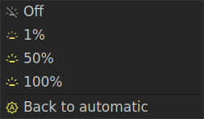
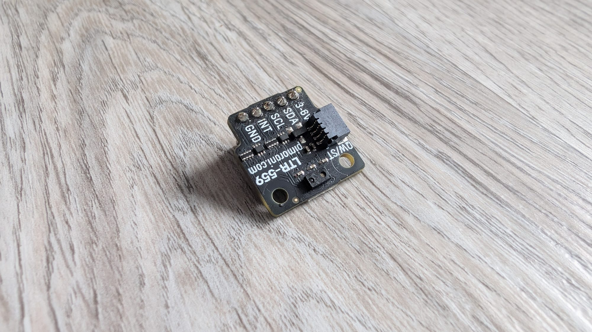

import { Aside } from '@astrojs/starlight/components';

The per-key OLEDs can be dimmed and brightened three different ways. Whichever you use, a
**manual** change takes priority until automatic mode is back on: you turn it on again, or
the keyboard reconnects to PolyKybdHost.

## Manual

- **On the keyboard** — the brightness preset keys step the keycap OLEDs up and down.
- **In PolyKybdHost** — pick a level from the tray's **Brightness** submenu, or set one
  under **Settings → Brightness**.
- **Command line** — `polyctl brightness <0–100>`.

A manual set switches automatic mode off, so the keyboard keeps exactly the level you picked.

### Going back to automatic

A manual level stays until you turn automatic mode back on, or until the keyboard
reconnects to PolyKybdHost (after a reboot, a replug or a host restart): on every connect
the host sets its brightness mode again. To turn automatic mode back on yourself, choose
**Brightness → Back to automatic** in the tray (or run `polyctl brightness --auto`).

If adaptive daylight brightness is switched off in Settings, that entry reads **Clear
manual override** instead: there is no automatic source to return to, so it just puts
the keyboard back on its own stored level.

## Adaptive (daylight)

PolyKybdHost can adjust to daylight: with location access enabled it computes the solar
irradiance for your position and time of day and slowly raises the brightness during the day and
lowers it in the evening. Enable it under **Settings → Brightness**. It refreshes roughly every ten
minutes.

It uses two online lookups, each with its own switch under **Settings → Brightness**:

- **Allow Online Location Lookup** finds your approximate location from your IP address
  (`ip-api.com`). Without a location, the brightness follows the hour of the day.
- **Allow Online Irradiance Request** asks `open-meteo.com` for this hour's sunlight at that
  location, clouds included. Without it, the host computes the sunlight of a cloudless sky.

If the curve does not suit your room, **Gamma** and the **Irradiance** values change it; see
the [Settings Reference](/software/settings/#brightness).

## On-board light sensor (optional)

The **Split72** has an expansion port for an optional ambient-light + proximity sensor
(Pimoroni LTR-559). If one is fitted, the keyboard sets its **own** brightness from the
measured light level — much faster than the host's daylight estimate (roughly twice a second)
— and overrides the host's daylight value while automatic mode is on.

The same sensor reads **proximity**: reach toward the keyboard and the displays wake before you
even press a key.

<Aside type="note">
The sensor is entirely optional. It works on whichever half it is soldered
to, and a keyboard without one simply uses the manual/daylight paths above. It is a Split72-only
feature (the Split42 has no expansion port).
</Aside>

<Aside type="tip">
Fitting the sensor is the **very first** assembly step — it does not fit through the plate hole,
so it can't be added later without taking the keyboard almost completely apart. See the soldering instructions in the
[Step-by-Step Build Guide](/assembly/step-by-step/) and the [Parts List](/assembly/parts-list/#ambient-light--proximity-sensor-highly-recommended).
</Aside>

