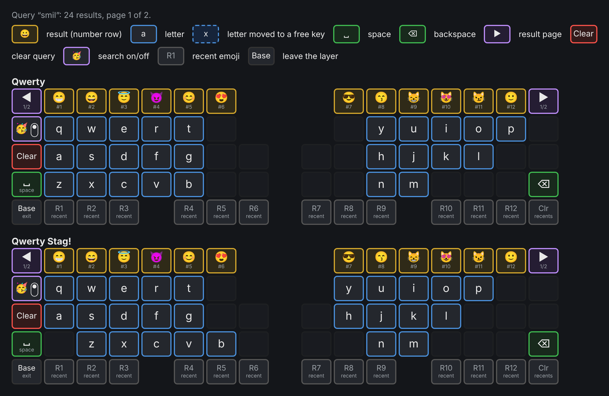

import { Aside } from '@astrojs/starlight/components';

<Aside type="note" title="Requirements">
Emoji search needs firmware 1.11.3 or newer and PolyKybdHost 1.21.0 or newer. It is on
**split72** only; split42 does not have it yet.
</Aside>

The [emoji layer](/using/languages/#emoji-layer) can find an emoji by a word. Type `smil` and
the number row shows the smiling faces; press one to type it. The keyboard searches a dictionary
stored in its flash, so the search works without the host app running. The keyboard types the
emoji as Unicode, so the [Unicode input mode](/using/languages/#unicode-input) must be set for
your OS.

## Searching

1. Open the emoji layer with the **emoji key** on the bottom letter row of the left half (right of
   **B** on Qwerty).
2. Tap the **mode key** at the Tab position. It shows 🔍 with a switch, knob down, in the normal
   tab mode, and 🥳 with the knob up in search mode.
3. Type a word. The letters are at their normal positions, in the keyboard's current
   [language](/using/languages/).
4. The **number row** shows up to 12 results, best match first. Press a result to type that
   emoji. **◀** (top left) and **▶** (top right) show the previous and next 12 results.



| Key | Search mode |
|---|---|
| Tab position | Mode key: switch between tab mode and search mode |
| Below the mode key | **Clear**: empty the query |
| Left Shift | **Space**, to start a second word |
| Right Shift | **Backspace** |
| Bottom row | Your recently used emoji |

The status display shows the query and the number of results. Switching between the two
modes keeps the query. Leaving the emoji layer clears it. The layer opens in the mode you used
last, also after a restart.

A letter whose key has a search function (a result, a page key, a recent emoji) moves to the
nearest free key on the same half of the keyboard. For example, Russian **х** and **ю** on Qwerty
move to a free key.

### How words match

- A word matches the start of any word in an emoji's name or keywords: `smil` finds *smile* and
  *smiling*, and `cafe` finds ☕.
- Two words find the emoji that match both: `red heart`.
- Upper and lower case and accents do not matter.
- When nothing matches, the search allows one wrong, missing or extra letter, or two
  swapped letters: `rokcet` still finds 🚀.
- The most common English keywords work in every language, so `smile` also works with the
  German dictionary.

## Dictionaries

PolyKybdHost has a dictionary for each of 79 languages, built from the Unicode CLDR emoji
names and keywords. English is the default.

- **Languages written in another script** (Russian, Greek, Arabic, Hindi and others): type the
  words in that script. English keywords are typed with the same keys that type the Latin
  letters on a standard keyboard of that language.
- **Japanese**: type the reading in romaji (`sumairu`). The English keywords work too.
- **Korean**: type the jamo keys as on a standard Korean keyboard.
- **Chinese**: there is a dictionary for each input method: Pinyin (Simplified Chinese, and Hong
  Kong), Zhuyin (Traditional Chinese, Taiwan) and Cangjie (Hong Kong). Type the key sequence of
  that method.

### Choosing the dictionary

- **Tray menu**: *Selected Language* → *Emoji Search Language*, then a language.
- **Settings dialog**: *Emoji* → *Search Language*.
- **Command line**: `polyctl emoji-dict list` shows the dictionaries and
  `polyctl emoji-dict set de` chooses one. `polyctl emoji-dict` shows which dictionary the
  keyboard holds.

The host writes the chosen dictionary to the keyboard right away. It is a
[font-pack](/firmware/font-packs/) bundle of up to 128 KB, so the keycaps show the
*Updating fonts* screen for a short time. Without a host, the keyboard keeps the dictionary it
has.

## Editing a dictionary

Every dictionary is a text file in the firmware repository,
[`keyboards/polykybd/emoji/dict_src/`](https://github.com/thpoll83/qmk_firmware/tree/PolyKybd/keyboards/polykybd/emoji/dict_src),
with one line per emoji: the codepoint, the name and the keywords, separated by tabs. Keywords
are separated by ` | `:

```
1F600	grinning face	cheerful | cheery | face | grin | grinning | happy
```

Any text editor can change it. A spreadsheet program can open it as tab-separated text; save it
back as tab-separated UTF-8 text without quotes.

To use your edited dictionary, build it with the `--user` option and choose the file in the
host. The build runs in a clone of the firmware repository
([thpoll83/qmk_firmware](https://github.com/thpoll83/qmk_firmware), branch `PolyKybd`) and
needs Python 3. Replace `de` with the id of the dictionary you edited: the file name in
`dict_src/` without `.tsv`, as `polyctl emoji-dict list` shows it.

```bash
git clone --depth 1 -b PolyKybd https://github.com/thpoll83/qmk_firmware.git
cd qmk_firmware/keyboards/polykybd/emoji
# edit dict_src/de.tsv, then:
python3 emoji_dict.py build de --user -o ~/my-de.plyd
polyctl emoji-dict file ~/my-de.plyd
```

In the tray, choose *Emoji Search Language* → *Own dictionary file...* instead of the
`polyctl` command.

- After the next edit, build the file again and choose it again. Choosing the file that is
  already in use writes it to the keyboard again.
- Choosing a language in the menu, or `polyctl emoji-dict file --clear`, returns to a
  dictionary that ships with the host.
- If the host cannot read the file, or the file is not a dictionary, it refuses the file, writes
  nothing, and the keyboard keeps its dictionary. `polyctl emoji-dict file` prints the reason,
  and the tray shows it in a message.
- If a file you chose earlier is moved, deleted or replaced by one that is not a dictionary, the
  host stops writing it. `polyctl emoji-dict` shows the reason, and the tray menu entry reads
  *Own dictionary (cannot be used)* with the reason in its tooltip.

To change a dictionary for everyone, open a pull request with the edited file. The firmware's
[`EMOJI_SEARCH.md`](https://github.com/thpoll83/qmk_firmware/blob/PolyKybd/keyboards/polykybd/emoji/EMOJI_SEARCH.md#editing-a-dictionary)
lists the steps.
