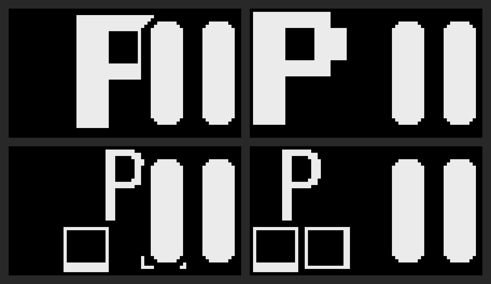

import { Aside } from '@astrojs/starlight/components';
import SupportedSince from '../../../components/SupportedSince.astro';

<SupportedSince protocol={9} note="expanded script set in v10" />

A **glyph script** is a purely cosmetic override that redraws the **letter and digit legends**
on the keycaps in an alternative script, while leaving everything else — app overlays, the
language layer, [shortcut hints](/using/shortcut-hints/) — exactly as it was. It changes the look of the keycaps without
changing what the keys actually type.

## Available scripts

| Script | Notes |
|---|---|
| **Standard** | Normal legends (the default — glyph script off). |
| **Tengwar** | Elvish-style feanorian script. Caseless. |
| **Runes** | Elder Futhark runic. |
| **Aurebesh** | Blocky sci-fi alphabet. |
| **Standard Galactic** | The "commander" alien alphabet. |
| **Cirth** | Angerthas-style runes. |
| **IBM VGA** | CP437 / DOS text-mode look. |
| **Commodore 64 (screen)** | The C64's built-in screen font, as it appeared on the monitor. |
| **Amiga** | Workbench / Topaz look. |
| **APL** | The APL symbol set. |
| **Braille** | Braille cell patterns. |
| **Commodore 64 (keycap)** | The narrow capitals printed on the C64's own keys. Each letter key also shows its two PETSCII graphics below the letter, as on the front of a real C64 key: Commodore + key on the left, Shift + key on the right. They are drawn only; the key still types the letter. |

<Aside type="note">
The scripts that have their own numerals (Tengwar, C64, …) also restyle the digit row; the
others leave numbers as normal. A key whose glyph the chosen script can't draw simply keeps its
normal legend — so the board never shows a blank key.
</Aside>

## Selecting a script

- **On the keyboard** — a key on the settings layer, under **More…**. Like the idle-style key
  it names the active value — `SCRIPT:` over the current script — and each tap moves to the
  next one, and after the last one it returns to Standard.
- **Tray menu** — right-click the PolyKybdHost tray icon → **Keycap Script** → pick a script
  (or **Standard** to turn it off).
- **Command line** — `polyctl glyph-script tengwar` (or `standard`, `runes`, `c64`, `c64keys`, `braille`, …).

Your choice is saved on the keyboard and persists across reboots.

## Placement: centred or top-left

<SupportedSince protocol={26} />

Placement needs firmware 1.10.2 and host 1.19.58 or newer.

By default the script's letters and digits are drawn large and centred. An app overlay draws
its icon on the right half of the keycap and clears a small border around it, so it can cut
into a centred letter. **Top-left** draws the letters and digits in the top-left corner
instead, and they stay whole next to the icon. On the Commodore 64 (keycap) script, the letter
and its two PETSCII graphics move to the left half of the key.

- **Tray menu** — **Keycap Script** → **Centred on the keycap** or **In the top-left corner**,
  below the list of scripts. The two entries are greyed out when the keyboard's firmware is
  older than 1.10.2.
- **Command line** — `polyctl glyph-script --placement top-left` (or `centre`). It can be
  combined with a script: `polyctl glyph-script c64 --placement top-left`.

The placement applies to every script and is saved on the keyboard with the script.
Choosing a script does not change the placement.

## Requirements

Glyph scripts are drawn from a **`fantasy` font-pack bundle** that PolyKybdHost flashes to the
keyboard automatically the first time it connects (see [Font Packs & Resources](/firmware/font-packs/)).
Until that bundle is present the override falls back to the normal Latin legends, so nothing
breaks if it hasn't been flashed yet.

To make the normal legends bigger instead of changing their style, use a separate setting:
see [Legend Size](/using/legend-size/).
