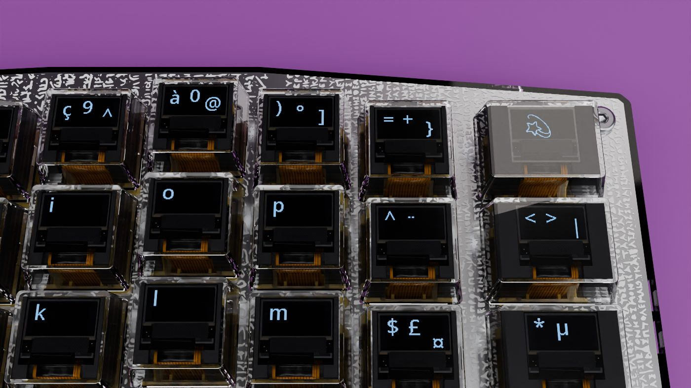
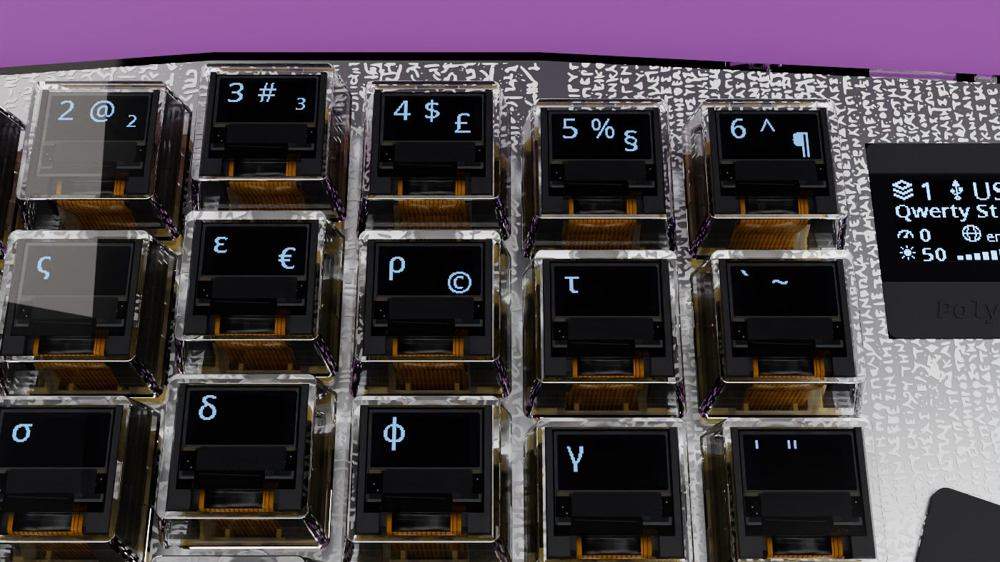
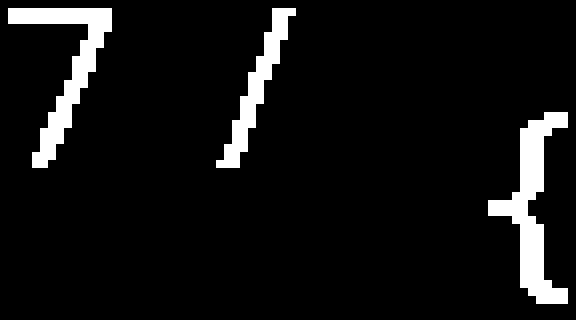
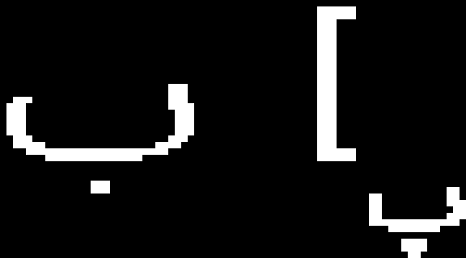
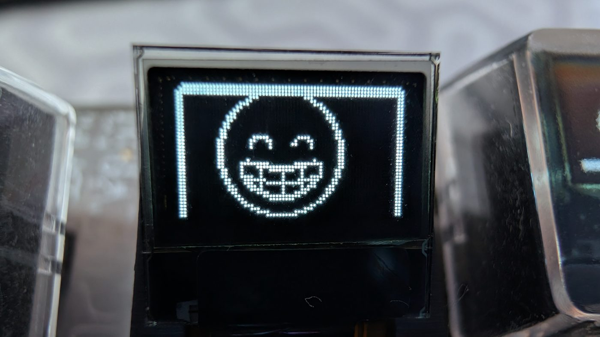

import { Aside, Tabs, TabItem } from '@astrojs/starlight/components';

PolyKybd does two related things with languages: it can **switch its on-screen keyboard layout**
between 161 languages, and it can **type Unicode characters** (emoji, accented letters) on any OS.

## The language layer

PolyKybd ships with **161 keyboard-language layouts**. Press the **Language/Globe** key
[ 🌐 ] to open the language picker. On this layer each key shows a **country flag** and its
**`xx-YY` language code** (for example `de-DE`, `fr-FR`, `es-MX`), with a frame drawn around the
currently selected language.

The languages are sorted by continent, with one tab per continent. When a continent has more
languages than keys, the two page keys show the current page and the page count next to the
arrow, for example ▶ 2/3.

Switching the layout redraws every keycap, accents and AltGr symbols included. Here the right
half on French AZERTY:



The left half on a Greek layout, a different script with no hardware change:



Pick a language and PolyKybd does two things at once:

- **Switches the keycap legends** so every key shows the characters for that layout.
- **Tells the host OS to switch input language**, so what you type matches what the keys show.

Your selection persists across reboots. Because the language list is shared by both hardware
variants, [split72 and split42](/firmware/variants/) support the same set of languages.

<Aside type="note">
To change the style of the legends (Tengwar, runes, Braille) without changing what the keys
type, use a separate, cosmetic feature: [Glyph Scripts](/using/glyph-scripts/).
</Aside>

## What a keycap shows

A single keycap shows up to three things at once, in fixed places:



- The **main legend**, drawn largest and to the left — what the key types on its own. Just how
  large is [adjustable](/using/legend-size/); these examples use the default.
- The **Shift preview**, small in the upper right — what you get holding Shift.
- The **AltGr hint**, small in the lower right — what you get holding AltGr.

The two small ones are previews, so you can find a symbol without searching for it. They appear
only when the key actually has something to show: on most layouts a plain letter has no Shift
preview, because its capital form is obvious.

<Aside type="tip" title="Wide scripts get a smaller AltGr hint">
On layouts with wide letters, such as Arabic and several Indic scripts, the AltGr hint is drawn
at half size (firmware **0.17.3** and later):


</Aside>

## The Intl layer: accented letters on demand

Switching your whole layout is the right choice when you *write* in another language. When you only
need the occasional accented letter — a name, a loanword, a single `ñ` in an English sentence —
there is the **Intl layer**. Hold the **Intl** key [ İñțł ] and the letters that have accented
forms show one:

| Hold Intl, press… | You get |
|---|---|
| `a` | `à` (or whichever variation you picked for `a`) |
| `s` | `ș` |
| `e` | `é` |

Press the letter and PolyKybd types that character — no dead keys, no compose sequence, no layout
switch. **Every letter of the alphabet** has variations — 549 in all, covering every accented
form Unicode has a single character for. `o` has the most at 36, then `a` and `u` at 30 and `e`
at 25; even `q` and `x` have a couple.

<Aside type="note">
Upper and lower case are chosen separately, so `Á` and `á` can be set to different accents. Hold
Shift (or turn on Caps Lock) to work on the capital.
</Aside>

### Choosing which accent a letter types

Each letter remembers **one** variation at a time — the one on its keycap. To change it, use the
picker on the number row.

1. Hold **Intl**.
2. Press the letter you want to change, so the keyboard knows which one you mean.
3. Tap **Ctrl** [ Á»Æ ]. The Ctrl keycap turns **inverted** — dark legend on a lit key — to show
   the picker is active, and the number row fills with that letter's variations.
4. If the letter has more variations than fit in one row, step through them with the **page arrows** at either
   end of the picker row. The arrow keys show the current page and the page count, for example ▶ 2/3.
5. Press the key under the accent you want.

That becomes the letter's variation from then on, and it is kept after a reboot. The picker closes as
soon as you pick, and reopens on the first page.


### Giving one letter several keys

The picker chooses another *form* of the letter a key already has, so it can only ever give you
one accent per key. French needs `è` `é` and `ê` at the same time — three forms of one letter, and
only one `e` key to put them on.

So a key can be **reassigned to a different letter**:

1. Hold **Intl**.
2. Tap the **remap** key [ à»ñ ], next to the picker's Ctrl. It **inverts**, and every key goes blank
   except the keys you can choose from.
3. Press the key you want to change. It inverts too.
4. Press the letter it should type.

That key now has the chosen letter's variations, and its own picker works exactly as before —
so you can give each of them a different accent. `q` and `j` are good candidates: they have one and
two variations of their own, so they are almost unused on this layer otherwise.


**Punctuation keys can take a letter too** — `` ` `` `'` `,` `.` `/` `;` `[` `]` `=` on split72, and
`;` `,` `.` `/` on split42. Which ones you get is decided by the layout: a key that isn't on the
Intl layer is never available. An unmapped punctuation key keeps typing its own symbol, so
nothing changes until you deliberately remap it.

<Aside type="note">
The remap key **stays on** after you release it. Tap it, do not hold it. Releasing **Intl** leaves the mode at any point, so
that always exits the mode. Tapping the remap key again also exits.
</Aside>

<Aside type="tip">
There are two ways to undo this. Re-assigning a key to **its own letter** clears just that key (for a punctuation key,
press the highlighted key a second time). **Shift + remap** clears every assignment at once — worth
knowing, because once the board is remapped the Intl legends no longer match the letters printed on
your keycaps.
</Aside>

### When a letter needs more than one row

The picker row holds 12 variations at a time on split72 and 10 on split42, so the letters with the most variations
span several pages. The two **page arrows** are at the **outer ends** of the row — back on the far
left of the left half, forward on the far right of the right half. They **wrap** in both
directions, and each shows the current page and the page count next to its arrow (◀ 2/3).

| | Letters that page | Most pages |
|---|---|---|
| split72 (12 per row) | `a` `e` `i` `o` `u` | 3 (`o`) |
| split42 (10 per row) | `a` `e` `i` `n` `o` `s` `t` `u` `y` | 4 (`o`) |

Every other letter fits on a single row, and there the arrows stay **blank** — if you see no arrows,
you are already looking at all of them.

<Aside type="note">
What gets stored is the accent itself, not its position on the row. Your choices therefore stay the same
when you move from a split72 to a split42 — though with 12 variations per page against 10, the same
accent may appear on a different page and a different key there.
</Aside>

<Aside type="tip">
The picker **stays on** after you release Ctrl, so you do not have to hold it down. Tap it to activate, tap it again to close
it without changing anything — leaving the Intl layer closes it too. While it is active you can press
a different letter to switch which one you're setting, and add or release Shift to switch between the
capital and lower-case rows; the number row re-renders each time.
</Aside>

The inverted Ctrl keycap is the thing to look for: if it's lit, the number row is a picker and the
digits won't type numbers.

### Romanian and the comma-below letters

Romanian's `ș` and `ț` use a **comma** below the letter, not a cedilla — `ș` is a
different character from `ş`, and using the wrong one is a spelling error in Romanian. Both cases of
both letters are available as variations of `s` and `t`.

### What the full set adds

The picker now contains every accented letter that Unicode encodes as a **single character**. These
are the writing systems that gained the most from that — the middle column is what was missing
before, not the whole of what each one uses:

| Language or system | Letters it gained |
|---|---|
| Welsh | `ẁ ẃ ẅ ỳ` — the grave, acute and diaeresis forms of `w` and `y` (the circumflex `ŵ ŷ` were already there) |
| Irish | the séimhiú dotted consonants `ḃ ċ ḋ ḟ ġ ṁ ṗ ṡ ṫ` |
| Guaraní | `Ẽ` and `Ỹ`, the capitals that had no partner for the existing lower-case forms |
| Vietnamese | the horned vowels `ơ ư`, including their tone combinations |
| Pinyin | 3rd-tone carons and the full `ü` set |
| African reference alphabet | the hook letters `ɓ ɗ ƙ ƴ` and relatives |

<Aside type="caution">
A letter is only available here if Unicode gives it its own character. Guaraní's `g̃` is the one
that most often causes confusion: it has no character of its own — it is a `g` followed by a combining tilde
— so the picker cannot produce it, and Guaraní still needs a compose key or a layout switch for
that one letter.
</Aside>

<Aside type="caution">
The Intl layer types its letters as **Unicode**, the same path the emoji layer uses — so it needs
your OS input mode set up first. If Intl letters produce nothing (or the wrong thing), that is the
usual cause: see [Unicode input](#unicode-input) below.
</Aside>

<Aside type="note">
The Intl key is on the [split72](/firmware/variants/) keymap only. On split42 you can add it in the
[keymap editor](/using/keymap-editor/), and the layer behind it works there too.
</Aside>

## Japanese: ja-JP and ja-US

<Aside type="caution" title="Needs firmware 1.8.9 or later">
ja-US, the romaji legends on ja-JP and ja-JP's Caps Lock key were added in 1.8.9. Up to 1.8.8, ja-JP
keycaps show the kana only, and there is no ja-US.
</Aside>

Most Japanese typists use romaji input: they type `k` `a` and the IME turns it into か. So both
Japanese layouts show the Latin legend first, and each key's kana small in the lower right, the way
a printed JIS keycap does.

The two layouts differ only in punctuation, because the OS turns a key into a character with its
own keyboard layout setting. Pick the one that matches it:

- **ja-JP** is for the Japanese (JIS, 106/109-key) layout: Shift+2 is `"`, `@` sits next to P, and
  `:` is on the key right of `;`. The `` ` `` key is 半角/全角 there, an IME toggle, and shows
  **英数** over **かな**.
- **ja-US** is for the US (101-key) layout, with the US punctuation on the 14 keys where JIS
  differs. The letters, digits and kana are the same as on ja-JP.

Where the OS keeps that setting:

| OS | JIS → ja-JP | US → ja-US |
|---|---|---|
| Windows | Hardware keyboard layout "Japanese keyboard (106/109 key)" | "English keyboard (101/102 key)" |
| macOS | Keyboard type JIS | Keyboard type ANSI |
| Linux | Keyboard layout `jp` | Keyboard layout `us` |

On Windows the setting is under **Settings → Time & language → Language & region → Japanese →
Language options → Hardware keyboard layout**, and a change needs a restart. A Japanese edition of
Windows starts on 106/109; Japanese added to an English Windows stays on 101. macOS asks for the
keyboard type the first time it sees a keyboard it cannot identify. The keyboard cannot read any of
these settings, so you must select the layout yourself.

In the language layer the two sit side by side under Asia, both with Japan's flag.

## The IME key: Korean, Japanese and US English

<Aside type="caution" title="Needs firmware 1.8.5 or later">
Older firmware has a plain Non-US Backslash key in this position. The ja-JP row describes
1.8.9 and later (see [Japanese](#japanese-ja-jp-and-ja-us) above). On 1.8.5 to 1.8.8, ja-JP
sends what the ja-US rows list.
</Aside>

Korean and Japanese are typed through an input method (IME), and the IME has its own on/off
mode. On the split72 keymap, the key that is Non-US Backslash on other layouts switches that mode
for you. On the US-style English layouts, where Non-US Backslash only repeats the Backslash key,
it becomes a second Alt key on the right-hand side. The keyboard chooses what to send from the active
language and the OS:

| Language | Windows | Linux, Android | macOS |
|---|---|---|---|
| ko-KR | 한/영: switches between Hangul and Latin | 한/영 | Ctrl+Space: the previous input source, so Hangul ↔ Latin only while those are the last two you used |
| ja-JP | Caps Lock, which is 英数 on a JIS layout; Shift+Caps Lock is Caps Lock | Caps Lock, as on Windows | tap: 英数 ↔ かな; Shift+tap: katakana (Ctrl+Shift+K) |
| ja-US, tap | IME off ↔ hiragana (Shift+Caps Lock / Ctrl+Caps Lock) | 無変換 ↔ カタカナひらがな | 英数 ↔ かな |
| ja-US, Shift+tap | katakana (Alt+Caps Lock) | katakana (Shift+カタカナひらがな) | katakana (Ctrl+Shift+K) |
| en-US, en-CA, en-AU, en-NZ, en-IN, en-PH, en-SG | Right Alt | Right Alt | Right Option (⌥), for typing accented letters and symbols |
| any other language | Non-US Backslash, as before | Non-US Backslash, as before | Non-US Backslash, as before |

On ja-JP the key is a plain Caps Lock on Windows and Linux, because a JIS layout already has the
IME keys: Caps Lock is 英数 and the `` ` `` key is 半角/全角. macOS treats Caps Lock as Caps Lock
even on a JIS keyboard type, so there ja-JP keeps the 英数/かな key. On ja-US, Windows uses Microsoft
IME's Caps Lock shortcuts, which need no IME setting and work on the 101-key layout.

The keycap shows the label a Korean or Japanese keyboard prints on the key: **한/영** on
Korean, and **英数** over **かな** on Japanese, which changes to **カナ** while you hold Shift.
Where the key is Caps Lock it shows the Caps Lock legend. On the US-style English layouts it shows
the Alt legend, or ⌥ on macOS. On Windows that Right Alt is also the compose key of
[WinCompose](/software/wincompose/). On macOS the key is Right Option, not a second Cmd, because
Option is the macOS key that types characters (⌥E for an accent, ⌥2 for ™). These labels are built
into the firmware, so they show even without a font pack. On every other language the key shows
that layout's Non-US Backslash legend.

On ja-US, and on ja-JP under macOS, the keyboard cannot detect the IME's mode. If you change the
mode another way (the mouse, Alt+` or a Caps Lock shortcut), the next press can select the mode
you are already in. Press once more and
the key matches the IME mode again.

<Aside type="note" title="A keyboard with a saved keymap keeps the old key">
The base layouts are stored in the keyboard's memory once you have saved a keymap, and the saved copy
takes priority over new firmware. To get the IME key there, set its position in the
[keymap editor](/using/keymap-editor/), or write keycode `0x7FA8` with
`polyctl keymap set <layer> <row> <col> 0x7FA8`.
</Aside>

## Emoji layer

PolyKybd also has a dedicated **emoji layer** that turns the keycaps into a visual emoji picker —
each key previews an emoji, grouped into categories along the top row, so you choose one by sight
instead of memorising a codepoint. Your most recently used emoji are easy to reach.


Close up, a single 72×40 px keycap rendering one emoji:



There are 12 category tabs. On split72 they fill the top row, with a page key at each outer end.
On split42 they fill the two top rows of the left half, and the page keys are on the thumb row. A
category with more emoji than keys has several pages. The page keys show the current page and the
page count next to the arrow, for example ▶ 3/9, and they wrap in both directions. A category
with one page shows blank page keys.

### Symbols

The **Symbols & Marks** tab [ ✔ ] has the typographic and technical symbols that a layout does
not put on a key. In this order:

| Group | Symbols |
|---|---|
| Superscripts (first on the tab) | ⁰ ¹ ² ³ ⁴ ⁵ ⁶ ⁷ ⁸ ⁹ ⁺ ⁻ ⁼ ⁽ ⁾ ⁿ ⁱ |
| Most used | ° ± × ÷ µ © ® ™ § ¶ · • – … « » € £ ¥ ¢ ‰ |
| More punctuation | ‹ › „ “ ” ‘ ’ ¡ ¿ † ‡ |
| Fractions | ½ ⅓ ⅔ ¼ ¾ ⅕ ⅖ ⅗ ⅘ ⅙ ⅚ ⅐ ⅛ ⅜ ⅝ ⅞ ⅑ ⅒ ↉ ⅟ ⁄ |
| Subscripts | ₀ ₁ ₂ ₃ ₄ ₅ ₆ ₇ ₈ ₉ ₊ ₋ ₌ ₍ ₎ |
| Other letters and signs | ′ ″ ‚ ª º ¬ ¦ ₩ ₹ ₺ ₿ ℃ ℉ ℓ № ℗ ℠ ℮ |
| Greek | α β γ δ ε θ λ μ π σ τ φ ω Δ Σ Φ Ω |
| Math | − ∓ ≈ ≠ ≡ ≤ ≥ ≪ ≫ ∞ √ ∛ ∝ ∑ ∏ ∫ ∂ ∆ ∇ ∀ ∃ ∅ ∈ ∉ ∩ ∪ ⊂ ⊃ ⊆ ⊇ ∧ ∨ ⊕ ⊗ ⊥ ∠ ∴ ∵ ∘ ∙ ⋅ ∕ ⌀ |
| Arrows | ← ↑ → ↓ ↔ ↕ ↵ ⇐ ⇒ ⇔ |

For a fraction that has no character of its own, type a superscript, the fraction slash ⁄ and a
subscript: ³⁄₇.

After these come check marks, crosses, bracket ornaments and dingbat arrows.

The math symbols and arrows are in the symbol [font pack](/firmware/font-packs/), like the emoji.
Without a font pack their keys are blank. Everything above them is built into the firmware.
The keyboard types each symbol as Unicode, so the [Unicode input mode](#unicode-input) must be
set for your OS.

## Unicode input

PolyKybd also supports Unicode input for emoji, accented characters (Æ, Ç, È, …), and any other
Unicode codepoint. Because each OS handles Unicode input differently, you must first tell the
keyboard which mode to use.

### Selecting your OS input mode

Press the Language/Globe key [ 🌐 ] to reach the OS selection. Choose the entry matching your
operating system and preferred input method:

| Key label | Use on |
|---|---|
| Mac | macOS — requires setup below |
| Lnx | Linux with IBus and compatible apps/window managers |
| BSD | BSD (currently unimplemented in QMK) |
| Emcs | Emacs (untested) |
| Win | Windows, unicode up to U+FFFF (no emoji) — requires registry edit below |
| WinC | Windows with WinCompose installed — full unicode including emoji |

Your selection is saved to the keyboard and persists across reboots.

### Per-OS setup

<Tabs>
  <TabItem label="macOS">
    Follow the QMK macOS unicode setup guide:

    1. Open **System Settings → Keyboard → Text Input → Input Sources**
    2. Add the **Unicode Hex Input** input source
    3. Select it when you want to type unicode characters

    Then press **Mac** on the PolyKybd language selector.
  </TabItem>
  <TabItem label="Linux">
    IBus must be installed and running as your input method framework. Most major desktop
    environments (GNOME, KDE) support this.

    Press **Lnx** on the PolyKybd language selector.
  </TabItem>
  <TabItem label="Windows (basic)">
    Windows supports unicode input up to code point U+FFFF (this excludes emoji). First enable hex
    numpad input:

    ```bat
    reg add "HKCU\Control Panel\Input Method" -v EnableHexNumpad -t REG_SZ -d 1
    ```

    Log out and back in (or reboot) after running this.

    Then press **Win** on the PolyKybd language selector.

    <Aside>
    This method does not support emoji or characters above U+FFFF. For full unicode support on
    Windows, use WinCompose instead.
    </Aside>
  </TabItem>
  <TabItem label="Windows (WinCompose)">
    WinCompose adds a compose key mechanism to Windows with full unicode support including emoji.

    1. Download and install [WinCompose](/software/wincompose/) — we maintain a fork of Sam Hocevar's original, since it is no longer actively developed
    2. Launch it — it runs in the system tray
    3. Press **WinC** on the PolyKybd language selector
  </TabItem>
</Tabs>

### Typing unicode characters

Once your OS mode is set, press any key that has a unicode character assigned in the keymap (such as
an emoji or accented character). The keyboard sends the appropriate input sequence for your OS
automatically.

Unicode character assignments are configured in the QMK keymap source. See
[Keymaps & Layers](/using/keymaps/) for how to modify them.
