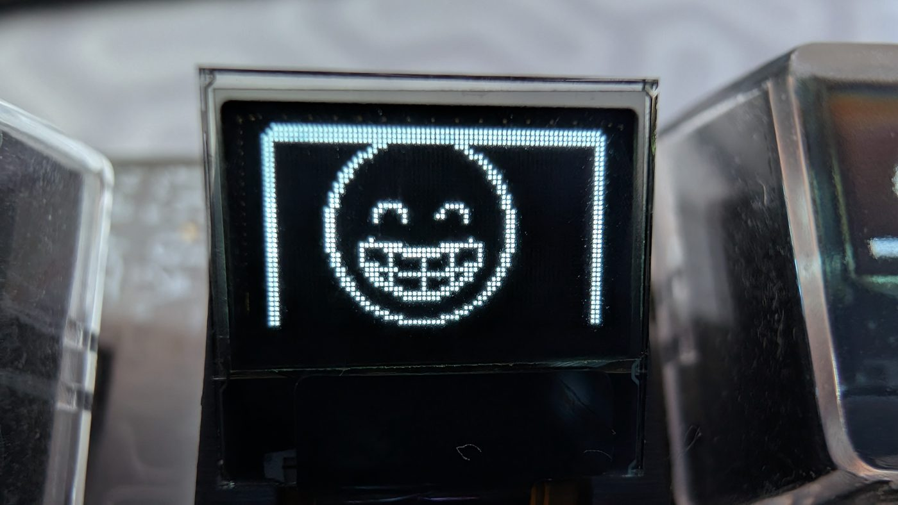

Part of [Languages & Unicode Input](/using/languages/).

## Emoji layer

PolyKybd also has a dedicated **emoji layer** that turns the keycaps into a visual emoji picker —
each key previews an emoji, grouped into categories along the top row, so you choose one by sight
instead of memorising a codepoint. Your most recently used emoji are easy to reach. On split72
you can also find an emoji by typing a word: see [Emoji Search](/using/emoji-search/).

Close up, a single 72×40 px keycap rendering one emoji:

There are 12 category tabs, in this order on the keyboard:

1. Smileys & Faces
2. Gestures, Body & Love
3. People & Jobs
4. Animals
5. Nature, Plants & Food
6. Weather & Sky
7. Travel & Places
8. Sports & Entertainment
9. Tools & Objects
10. Marks & Icons
11. Symbols & Math
12. Latin Extended

On split72 they fill the top row, with a page key at each outer end.
On split42 they fill the two top rows of the left half, and the page keys are on the thumb row. A
category with more emoji than keys has several pages. The page keys show the current page and the
page count next to the arrow, for example ▶ 3/9, and they wrap in both directions. A category
with one page shows blank page keys.

### Symbols

The **Symbols & Math** tab [ ± ] has the typographic and technical symbols that a layout does not
put on a key. The tabs as described here need firmware 1.9.16 and PolyKybdHost 1.18.0. In this
order:

| Group | Symbols |
|---|---|
| Superscripts (first on the tab) | ⁰ ¹ ² ³ ⁴ ⁵ ⁶ ⁷ ⁸ ⁹ ⁺ ⁻ ⁼ ⁽ ⁾ ⁿ ⁱ |
| Subscripts | ₀ ₁ ₂ ₃ ₄ ₅ ₆ ₇ ₈ ₉ ₊ ₋ ₌ ₍ ₎ |
| Most used | ° ± × ÷ µ © ® ™ § ¶ · • – … « » ‰ |
| Currency | € £ ¥ ¢ ₹ ₽ ₩ ₺ ₿ ₪ ₫ ₱ ₼ ₴ ₦ ₡ ₲ ₵ ₸ ₾ ₮ ₭ ⃀ ₨ $ ֏ ৳ ௹ ฿, then the historical ₣ ₤ ₧ ₠ ₯ ₰ ₳ ₢ ₥ ₶ ₷ ₻ and the generic ¤ |
| More punctuation | ‹ › „ “ ” ‘ ’ ¡ ¿ † ‡ |
| Fractions | ½ ⅓ ⅔ ¼ ¾ ⅕ ⅖ ⅗ ⅘ ⅙ ⅚ ⅐ ⅛ ⅜ ⅝ ⅞ ⅑ ⅒ ↉ ⅟ ⁄ |
| Other letters and signs | ′ ″ ‚ ª º ¬ ¦ ℃ ℉ ℓ № ℗ ℠ ℮ |
| Greek | α β γ δ ε θ λ μ π σ τ φ ω Δ Σ Φ Ω |
| Math | − ∓ ≈ ≠ ≡ ≤ ≥ ≪ ≫ ∞ √ ∛ ∝ ∑ ∏ ∫ ∂ ∆ ∇ ∀ ∃ ∅ ∈ ∉ ∩ ∪ ⊂ ⊃ ⊆ ⊇ ∧ ∨ ⊕ ⊗ ⊥ ∠ ∴ ∵ ∘ ∙ ⋅ ∕ ⌀ |
| Arrows | ← ↑ → ↓ ↖ ↗ ↘ ↙ ↔ ↕, ⇐ ⇑ ⇒ ⇓ ⇖ ⇗ ⇘ ⇙ ⇔ ⇕, ⟵ ⟶ ⟷ ⟸ ⟹ ⟺, ⟻ ⟼ ⟽ ⟾ ↤ ↦ ↥ ↧, ↩ ↪ ↞ ↠ ↟ ↡ ↢ ↣ |
| More arrows | ↚ ↛ ↮ ⇍ ⇏ ⇎, ⇄ ⇆ ⇋ ⇌ ↼ ↽ ⇀ ⇁ ↾ ↿ ⇂ ⇃, ⇇ ⇉ ⇈ ⇊ ⇶ ⇚ ⇛, ↜ ↝ ⇜ ⇝ ↭ ⟿, ⇷ ⇸ ⇹ ⇺ ⇻ ⇼ ⇽ ⇾ ⇿, ↯ ↺ ↻ ⟰ ⟱ ⟴ ⇴ |

For a fraction that has no character of its own, type a superscript, the fraction slash ⁄ and a
subscript: ³⁄₇.

A superscript or subscript key shows a full-size x in front of the character (x², x₂), so you can
tell the two apart. Pressing the key types only the character.

The **Marks & Icons** tab [ ✔ ] next to it has check marks, crosses, ballot boxes, bracket ornaments,
dingbat arrows and, at the end, the keyboard arrows: ↵ ↰ ↱ ↲ ↳ ↴ (enter), ⇤ ⇥ ↹ (tab),
⇧ ⇪ ⇫ ⇬ ⇭ ⇮ ⇯ ⇰ ⇳ ⇦ ⇨ ⇩ (shift and caps lock), ⇞ ⇟ ⇱ ⇲ ↸ (page up, page down, home, end),
↶ ↷ ⟲ ⟳ (undo, redo), ⇅ ⇵ ↨, ⇠ ⇡ ⇢ ⇣ and ↫ ↬. After them come arrows in every direction, in many
styles: thin, heavy, wide-headed, triangle-headed and outlined (⬅ ⬆ ⬇ ⬈ ⬉ ⬊ ⬋ 🡐 🡑 🡒 🡓 🡔 🡕 🡖 🡗 and more),
paired, circled, corner and ribbon arrows. They are in the font pack.

The math symbols, the arrows and the currency signs ֏ ৳ ௹ ฿ are in the [font pack](/firmware/font-packs/),
like the emoji. Without a font pack, a key whose symbol or emoji is in the pack shows **Glyph
missing!** instead. Pressing it still types the character. With **Settings → Keyboard → Send font packs on connect**
on (the default), PolyKybdHost flashes missing or outdated bundles when the keyboard connects. With it
off, use **Updates → Keyboard fonts** or `polyctl fontpack sync`. The rest is built into the firmware.
The keyboard types each symbol as Unicode, so the [Unicode input mode](/using/languages/#unicode-input) must be
set for your OS.
