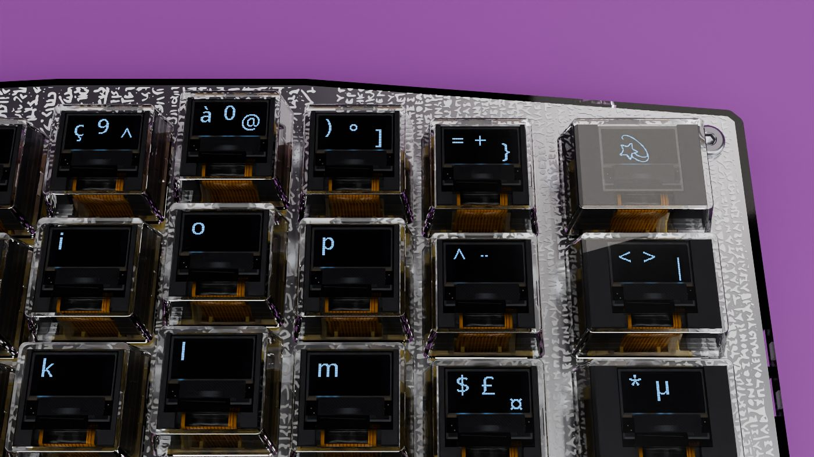
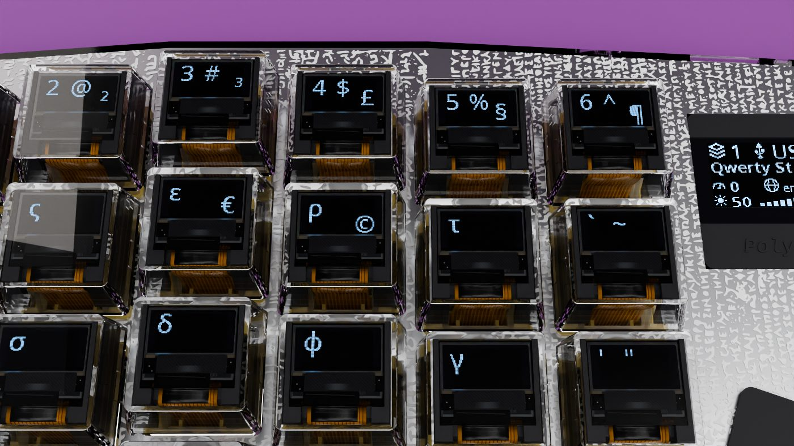
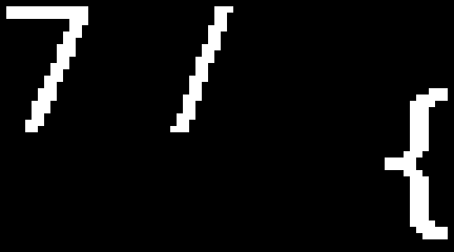
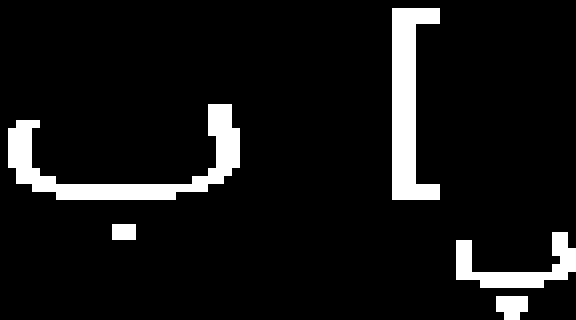

import { Aside, Tabs, TabItem } from '@astrojs/starlight/components';

PolyKybd does two related things with languages: it can **switch its on-screen keyboard layout**
between 161 languages, and it can **type Unicode characters** (emoji, accented letters) on any OS.

## The language layer

PolyKybd ships with **161 keyboard-language layouts**. Press the **Language/Globe** key
[ 🌐 ] to open the language picker. On this layer each key shows a **country flag** and its
**`xx-YY` language code** (for example `de-DE`, `fr-FR`, `es-MX`), with a frame drawn around the
currently selected language.

The languages are sorted by continent, with one tab per continent. When a continent has more
languages than keys, the two page keys show the current page and the page count next to the
arrow, for example ▶ 2/3.

Switching the layout redraws every keycap, accents and AltGr symbols included. Here the right
half on French AZERTY:



The left half on a Greek layout, a different script with no hardware change:



Pick a language and PolyKybd does two things at once:

- **Switches the keycap legends** so every key shows the characters for that layout.
- **Tells the host OS to switch input language**, so what you type matches what the keys show.

Your selection persists across reboots. Because the language list is shared by both hardware
variants, [split72 and split42](/firmware/variants/) support the same set of languages.

<Aside type="note">
To change the style of the legends (Tengwar, runes, Braille) without changing what the keys
type, use a separate, cosmetic feature: [Glyph Scripts](/using/glyph-scripts/).
</Aside>

## What a keycap shows

A single keycap shows up to three things at once, in fixed places:



- The **main legend**, drawn largest and to the left — what the key types on its own. Just how
  large is [adjustable](/using/legend-size/); these examples use the default.
- The **Shift preview**, small in the upper right — what you get holding Shift.
- The **AltGr hint**, small in the lower right — what you get holding AltGr.

The two small ones are previews, so you can find a symbol without searching for it. They appear
only when the key actually has something to show: on most layouts a plain letter has no Shift
preview, because its capital form is obvious.

<Aside type="tip" title="Wide scripts get a smaller AltGr hint">
On layouts with wide letters, such as Arabic and several Indic scripts, the AltGr hint is drawn
at half size (firmware **0.18.4** and later):


</Aside>

## Unicode input

PolyKybd also supports Unicode input for emoji, accented characters (Æ, Ç, È, …), and any other
Unicode codepoint. Because each OS handles Unicode input differently, you must first tell the
keyboard which mode to use.

### Selecting your OS input mode

Press the Language/Globe key [ 🌐 ] to reach the OS selection. Choose the entry matching your
operating system and preferred input method:

| Key label | Use on |
|---|---|
| Mac | macOS — requires setup below |
| Lnx | Linux with IBus and compatible apps/window managers |
| BSD | BSD (currently unimplemented in QMK) |
| Emcs | Emacs (untested) |
| Win | Windows, unicode up to U+FFFF (no emoji) — requires registry edit below |
| WinC | Windows with WinCompose installed — full unicode including emoji |

Your selection is saved to the keyboard and persists across reboots.

### Per-OS setup

<Tabs>
  <TabItem label="macOS">
    Follow the QMK macOS unicode setup guide:

    1. Open **System Settings → Keyboard → Text Input → Input Sources**
    2. Add the **Unicode Hex Input** input source
    3. Select it when you want to type unicode characters

    Then press **Mac** on the PolyKybd language selector.
  </TabItem>
  <TabItem label="Linux">
    IBus must be installed and running as your input method framework. Most major desktop
    environments (GNOME, KDE) support this.

    Press **Lnx** on the PolyKybd language selector.
  </TabItem>
  <TabItem label="Windows (basic)">
    Windows supports unicode input up to code point U+FFFF (this excludes emoji). First enable hex
    numpad input:

    ```bat
    reg add "HKCU\Control Panel\Input Method" -v EnableHexNumpad -t REG_SZ -d 1
    ```

    Log out and back in (or reboot) after running this.

    Then press **Win** on the PolyKybd language selector.

    <Aside>
    This method does not support emoji or characters above U+FFFF. For full unicode support on
    Windows, use WinCompose instead.
    </Aside>
  </TabItem>
  <TabItem label="Windows (WinCompose)">
    WinCompose adds a compose key mechanism to Windows with full unicode support including emoji.

    1. Download and install [WinCompose](/setup/wincompose/) — we maintain a fork of Sam Hocevar's original, since it is no longer actively developed
    2. Launch it — it runs in the system tray
    3. Press **WinC** on the PolyKybd language selector
  </TabItem>
</Tabs>

### Typing unicode characters

Once your OS mode is set, press any key that has a unicode character assigned in the keymap (such as
an emoji or accented character). The keyboard sends the appropriate input sequence for your OS
automatically.

Unicode character assignments are configured in the QMK keymap source. See
[Keymaps & Layers](/using/keymaps/) for how to modify them.

## More language pages

- [The Intl Layer: Accented Letters](/using/languages/intl-layer/): accented letters on demand.
- [Japanese and Korean Input](/using/languages/cjk-input/): ja-JP, ja-US and the IME key.
- [Emoji Layer](/using/languages/emoji-layer/): the emoji and symbol layer.
