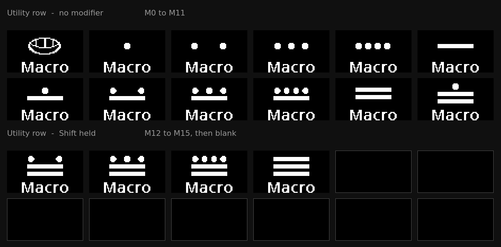

import { Aside } from '@astrojs/starlight/components';
import SupportedSince from '../../../components/SupportedSince.astro';

<SupportedSince protocol={15} />

A **macro** is a piece of text — or a short sequence of keys — stored on the keyboard and typed
back when you press one key. An email address, a login, a shell command, a phrase you write ten
times a day.

Every keyboard with macros has this. What is different here is that the **keycap shows which
macro it is**. A macro key shows a short label along its bottom edge, so the row reads `push`,
`work mail`, `sign off` rather than M0, M1, M2.

<Aside type="note" title="You need the release that includes them">
Macros were added after the **v0.15.14** firmware / **v0.13.16** host release. If the Keymap Editor
has no **Macros** tab, one of the two is older than that: update the host app from the tray
(**Updates → Check for updates**), then the keyboard from the same menu.
</Aside>

## Where they already are

You do not have to place a macro before you can press one. The **Utility layer**'s top row
*is* the macro row: twelve keys, `M0` to `M11` from left to right across the two halves.

To reach it, hold **Fn** and tap the **top-left** key: that switches to Utility for a single
keypress, so the very next key you press runs its macro. To stay on the layer instead — for
several macros in a row — hold **Fn** and tap the **top-right** key.

The last four macros share the same twelve keys: **hold Shift** and the first four become `M12`
to `M15`. The other eight go blank while Shift is down, which shows where the
second group of macros ends.



<Aside type="caution" title="F13–F24 are no longer on the default keymap">
That row used to be **F13** through **F24**. If you use them, put them back from the Keymap
Editor — they are still normal keycodes, but they are not on the default keymap any
more.
</Aside>

## Writing one

You edit macros in the **Keymap Editor** — open the tray menu and choose **Configure Keymap**, then
the **Macros** tab beside *Layers & Mods*.

1. Pick a macro from the list on the left.
2. Type the **label** — what the keycap will show.
3. Type **what it types** in the field below.
4. **Save macro**.

That is enough to use it — macro `0` is already on the first key of the Utility row. Step 5 is
only if you want it somewhere else:

5. Click the key you want it on in the keyboard picture, then **Use on selected key**.

The label field shows the keycap exactly as it will look, next to a meter of how much of the
72-pixel-wide display the label uses. Both update as you type.

<Aside type="tip" title="The meter counts pixels, not letters">
The keycap face is proportional, so how many letters fit depends on which letters they are. A
short label gets the larger of two faces. A longer one uses the smaller face and keeps every
character. That is about **nine characters** at the large face and **twelve** at the small one.
Anything past the edge is not drawn, and the meter turns amber before you save.
</Aside>

## Triggering a macro with a modifier

A macro takes a whole key. It cannot be combined with a modifier the way `Ctrl+C` or a
tap-hold key is.

Use a **layer** instead, which is how the keyboard expresses "modifier + key" for anything
that is not a plain keystroke:

1. In the Keymap Editor, switch to a layer above the base one — `Fn`, `Numpad` or `Utility`.
2. Assign the macro to a key there, exactly as on the base layer.
3. Hold that layer's key and press it — **Fn** + **E**, say.

The keycap shows the macro's label while the layer is held, so the assignment is visible on
the board rather than something you have to remember.

<Aside type="note" title="Modifiers *inside* a macro are a different thing">
This is about how you *trigger* a macro. A macro can also *send* modifier key combinations — a
`Ctrl`+`S` in the middle of one — and those are written in the **step editor** below.
The `Types:` field itself only ever produces plain characters, and `polyctl macro set
--text` likewise; a macro that holds key combinations or pauses shows a summary there and is
edited through **Steps…**.
</Aside>

## Key combinations, pauses and held keys

A macro is really a list of **steps**, and plain text is the common case rather than the
only one. Press **Steps…** beside the `Types:` field to open the step editor:

| Action | What it does |
| --- | --- |
| **Tap** | press and release one key |
| **Hold** | press a key and leave it down |
| **Release** | release a held key |
| **Wait** | pause, in milliseconds |
| **Type** | one character, as the text field produces |

Each row is an action and its **Value** — a key for Tap, Hold and Release, a duration
for Wait — in a single column, so a row only ever offers the one editor its action can
use.

A key combination is a Hold, the key, then a Release — `Ctrl`+`Shift`+`P` is *Hold Ctrl, Hold
Shift, Tap P, Release Shift, Release Ctrl*. The line under the table names what the
macro does in ordinary terms as you build it, so you can check it without reading the
rows back.

### Recording

Rather than adding those five rows by hand, press **Record** and then press the keys.
Every press and release is captured in order; press **Stop** (or `Esc`) when you are
done. The rows are ordinary steps afterwards, so anything captured wrongly can be
edited or deleted.

Two things worth knowing:

- **Pauses are not recorded by default.** Most macros should run as fast as the keyboard
  can send, and a `Wait` between every keystroke makes the list longer and uses space
  in the shared store. Switch the box beside Record to *with timing* if the timing
  matters — for example, for an application that drops input sent too quickly.
- **Recording reads the character a key produces, not its position.** On a layout where
  the key in the QWERTY `Y` position types `z`, that key records as `KC_Z` — the keycode
  that types `z` on *your* machine, which is what you meant by pressing it. It is only
  wrong if the macro will be replayed on a machine set to a different layout,
  and every step names the keycode it stored, so you can see and change it.

Leaving a modifier held at the end of a macro is allowed — the summary says so
(`hold Ctrl`) instead of removing it without telling you.

### Writing it as text

The step editor has two tabs. **Table** is the one above; **Script** is the same macro
as a line of text.

```
{+KC_LCTL}{KC_A}{-KC_LCTL}{50}done
```

| Written | Means |
| --- | --- |
| `done` | type the characters |
| `{KC_A}` | tap |
| `{+KC_LSFT}` | hold |
| `{-KC_LSFT}` | release |
| `{250}` | wait, in milliseconds |
| `\{` | a literal `{` |

Switching tabs converts the macro rather than replacing it, so use whichever is easier
for the task. For example, build a key combination by recording it, then switch to Script to change one keycode. If
the script does not parse, the tab does not change, your text stays as it is, and the
problem is named underneath.

**Record** works on either tab: it appends to whichever one you are looking at. The
row buttons — add, remove, reorder — belong to the Table tab, since that is what they
act on.

<Aside type="tip" title="This is VIA's syntax, on purpose">
It is the same text [VIA](https://usevia.app/) uses, so a macro can be pasted between
the two. Two differences: VIA's `{KC_LSFT,KC_A}` shorthand is not read here — write the
keys out, or use the table — and both apps accept QMK's short names, so `{KC_LSFT}` and
`{KC_LEFT_SHIFT}` mean the same key. PolyKybd prints the long form back.
</Aside>

## What a macro can type

Printable ASCII, tab and newline. That is what a keyboard can actually send: it types
**keystrokes**, not characters, so anything your keyboard layout cannot produce with a keypress —
an accented letter, an emoji, a character from another script — is not something a macro can type.

If you need those, the keyboard has better tools for it: the
[language layer](/using/languages/) for accented letters and other scripts, and the emoji layer
for emoji.

<Aside type="caution" title="A macro is stored as plain text">
Macros are kept on the keyboard as plain text, and anything on your computer that can communicate with the
keyboard over USB can read them back. That is fine for an email address or a git command. Do not
store a password in a macro.
</Aside>

## What the keycap shows

A macro takes a whole key, so the whole key can show the macro's label and icon. Four layouts, chosen
per macro from the **Keycap** dropdown in the editor:

| Layout | What it draws |
|---|---|
| **Icon above the label** | A symbol you pick, over the label. The default on a new keyboard. |
| **Number above the label** | `M3` over the label — the plain fallback, and the only one that needs nothing else. |
| **Label only, as large as it fits** | No mark at all — the label gets the whole key, at the largest face it fits on. |
| **Icon only, filling the key** | The icon alone, at full size across the whole key. The label is kept but not drawn, so switching back does not lose it. |

The label sits along the bottom edge. A macro with no label shows just the mark, centred.

### Before you write one

A macro you have never edited is not blank. Each of the sixteen starts with the **Mayan numeral
for its own number** over the caption `Macro` — a shell for zero, then dots and bars up to
fifteen.

Anything you set replaces it and is kept — the default look only fills a slot that has no
macro **and** no look of its own. Clearing a macro restores the numeral on its keycap.

<Aside type="note" title="They come from the font pack">
The numerals are stored in the keyboard's `symbol` font pack, which the host app flashes on connect. On
a keyboard that has never had one, those keys show `M0`…`M15` instead — the same fallback any
missing symbol takes, so a keycap is never left blank.
</Aside>

Labels are **ASCII only**. The small face has no accented letters, so anything outside the basic
alphabet, digits and punctuation is dropped as you type rather than appearing on the keycap as a
blank.

### Choosing an icon

**Choose icon…** opens a picker of the symbols and emoji the keyboard can draw — they come from
the font packs already on it, so what you see in the picker is what the key can show. It opens on
**Emoji and symbols**; **Show: Every bundle** shows everything on the keyboard, language
scripts included. Filter by typing a character or a codepoint (`1F4E7`, `U+2699`). **Clear** goes
back to no icon.

Next to a label, the icon is usually drawn at half size. Under **Icon only, filling the key**, or
on a key with no label, it gets the whole face.

<Aside type="note" title="An icon the keyboard cannot draw falls back to the number">
The picker only offers glyphs the keyboard has, so this is rare — but if a font pack is
re-flashed and a symbol is removed, that key shows its number again rather than going blank. The
editor says so too: the icon button reads `U+1F4E7 (no glyph)` when it cannot find one.
</Aside>

## Interrupting one

**Press any key.** A macro that is part-way through typing stops immediately, and the key you
pressed does what it normally does.

This is important: a macro can contain a deliberate pause, and the keyboard keeps
working normally while one runs — it does not lock up and finish before responding to you.

## From the command line

Everything above is scriptable:

```bash
polyctl macro list                                   # every macro, its label and size
polyctl macro set 0 --text "git push" --label "push"
polyctl macro set 0 --style icon --icon 1F4E7        # the keycap layout, and its symbol
polyctl macro set 0 --style icononly --icon 1F4E7    # …the symbol alone, filling the key
polyctl macro get 0
polyctl macro clear 0
```

`polyctl macro list` also prints how much of the shared store is in use.

`--text` writes plain characters. For key combinations and pauses use **`--script`**, the same
syntax as the editor's Script view:

```bash
polyctl macro set 0 --script "{+KC_LCTL}{KC_A}{-KC_LCTL}{50}done" --label "sel all"
```

`polyctl macro get` prints the script form beside the steps, so a macro built in the
editor can be copied directly. A script with a typo is refused before anything
is written, naming the token it could not read.

## How much fits

All the macros share one pool of about **2.2 KB** on the keyboard, across **16** slots. That is a
lot of text — an email address is around 25 bytes — but it is shared, so one very long macro
leaves less for the others. The editor shows the total at the bottom, and the keyboard refuses a
save that would not fit rather than truncating it.
