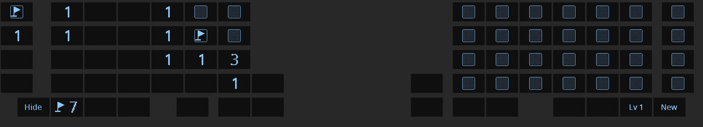
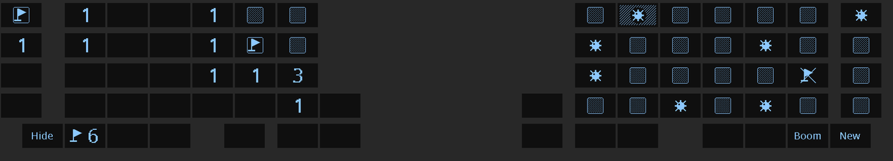
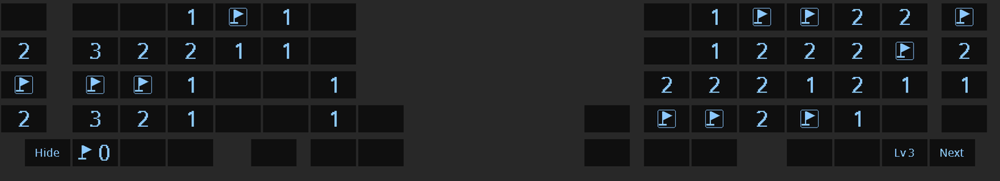

import { Aside } from '@astrojs/starlight/components';
import SupportedSince from '../../../components/SupportedSince.astro';

<SupportedSince firmware="1.9.0" note="Mines" />

Mines is a mine sweeper played on the keycaps. Each key above the thumb row is one cell, so
the keyboard is the screen and the controller at once. It sits behind the idle screen, it is
quiet to play, and one key puts the idle animation back.

## Start a game

1. Wait until the keyboard shows its [idle animation](/using/idle/) (Pulse, Jitter or Eden).
2. **Hold Hyper for one second.**

A short tap on Hyper only wakes the keyboard, like any other key, so the game does not start
by accident. Pressing another key while you hold Hyper cancels the start.

On the default split72 layout, Hyper is the key left of `Y`. The split42's default layout has
no Hyper key; give one a key with the [Keymap Editor](/using/keymap-editor/) to play there.

<Aside type="note">
You cannot start Mines from the IDDQD demo. Pick Pulse, Jitter or Eden as your
[idle style](/using/idle/#idle-styles) to play Mines.
</Aside>

## Play

| Board | Cells | Mines on level 1 |
|---|---|---|
| split72 | 14 × 4 (56) | 9 |
| split42 | 12 × 3 (36) | 6 |

The board is the main block of both halves side by side. The inner edge of the left half
counts as next to the inner edge of the right half, as if the gap were not there.

| To | Do |
|---|---|
| Open a cell | Tap it. |
| Place or remove a flag | Hold the key for about a third of a second. The flag appears while you still hold it; letting go then does nothing. |
| Open all neighbours of a number | Tap the number once its neighbours have that many flags. A wrong flag loses the game. |

The first tap of a game never hits a mine: it always opens at least the 3 × 3 area around
the key. When a tap opens an empty area, the keys open one after another, outward from the
key you tapped.

The thumb row holds the controls:

| Key (split72) | Shows | Does |
|---|---|---|
| Left thumb row, outermost | `Hide` | Back to the idle animation. The game is kept. |
| Next to it | A flag and a number | Mines minus the flags you placed. |
| Right thumb row, second from the end | `Lv 1`, `Lv 2`… or `Boom` | The level, or that you hit a mine. |
| Right thumb row, outermost | `New`, or `Next` after a win | A new board. |

On the split42 the same four controls sit on the thumb keys: `Hide` and the flag counter on
the left, the level and `New` on the right.

When you hit a mine, the board shows every mine, marks the one you hit, and crosses out any
flag that was wrong.

## Levels

Clear a board and `New` turns into **`Next`**. Each level adds one mine: level 1 has 9 on the
split72, level 3 has 11. The count stops growing at 47 mines on the split72 and 27 on the
split42, the most that still leaves the first tap a free 3 × 3 area.

`New` in the middle of a game, or after a loss, starts again at level 1.

## Hide and resume

Tap **`Hide`** and the normal legends come back for a moment, then the idle animation
starts again. If you type something in that moment, the keyboard stays awake for typing. After
**two minutes** without a key press the game hides itself the same way.

Hold Hyper on the idle screen again to resume:

- an unfinished board comes back exactly as you left it;
- a cleared board goes on to the next level;
- a lost board starts again at level 1.

The game is stored only in the keyboard's working memory. Unplugging the keyboard or restarting it ends
the game.

<Aside type="caution">
While Mines runs, **no key press reaches the computer.** Every key is a cell or a control.
Hide the game, or wait for the idle animation, before you type again.
</Aside>
