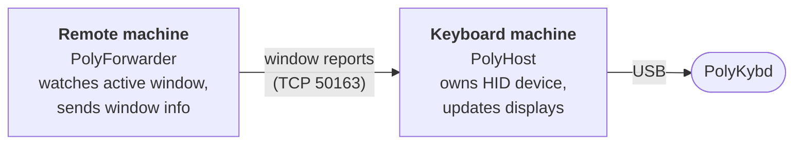
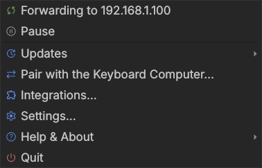

import { Aside } from '@astrojs/starlight/components';

PolyKybdHost supports a forwarder mode that lets a single PolyKybd serve multiple computers. The keyboard is physically connected to one machine, but the key displays reflect the active window on whichever machine you are currently working on.

## How it works



- **Keyboard machine**: running PolyKybdHost in normal mode, physically connected to the keyboard
- **Remote machine(s)**: running PolyKybdHost in forwarder mode (`--host <IP>`), no keyboard attached

When focus changes on a remote machine, it sends the window title and app info to the keyboard machine, which then updates the key displays.

## Before you start

Two things are easy to miss, and each one on its own makes the setup fail with no visible error.

**The network transport is off by default.** PolyKybdHost does not listen for window reports until you turn the listener on — step 1 below. Without it the forwarder just logs a connection error every few seconds.

**You need a `remote` entry in your overlay mapping.** The keyboard machine only uses a forwarded window while its *own* focused window is an app marked `remote` in `overlay-mapping.poly.yaml` — normally the remote-desktop client you are viewing the other machine through. The shipped mapping already covers NoMachine:

```yaml
nxplayer:
  remote: true
  title: ' - NoMachine$'
```

The title pattern matches a session window, which NoMachine titles `<host> - NoMachine`. The
connection chooser, titled `NoMachine` alone, is not a remote session and does not match.

From PolyKybdHost 1.28.29 it also covers the Windows Remote Desktop Connection client:

```yaml
mstsc:
  remote: true
  title: ' - Remote Desktop Connection$'
```

A session window is titled `<computer> - <address> - Remote Desktop Connection`. The connection
dialog, titled `Remote Desktop Connection` alone, does not match. The title is in the display
language of Windows, so on a localized Windows, change the end of the pattern to that language's
title.

Add an entry the same way for whichever client you use. While that window has focus, the keycaps follow the app focused *inside* the remote session; when you switch back to a local window, they follow that local window again.

## Setup

### 1. Turn on the window-report listener (keyboard machine)

```bash
polyctl settings set window_report_network_enabled true
```

Then **restart PolyKybdHost** — the setting is read once at startup, so it does not take effect until the daemon restarts.

Allow inbound TCP on **port 50163** in the keyboard machine's firewall.

<Aside type="caution">
  The listener is only started by the background daemon, not by a GUI running with `--no-daemon`. Daemon mode is the default; if you have turned it off, check with `polyctl settings get daemon_mode` and switch it back on for this feature.
</Aside>

After the restart the log should contain:

```
Window-report network listener on 0.0.0.0:50163 (auth-gated, 'window.report' only)
```

<Aside type="tip" title="Pair instead of copying the key (PolyKybdHost 1.22.4+)">
Instead of steps 2 and 3 you can pair the forwarder: choose **AI Agents → Pair a Forwarder…** in
the keyboard machine's tray menu, then **Pair with the Keyboard Computer…** in the forwarder's tray
menu, enter the code and restart the forwarder. A paired forwarder uses the authenticated
connection without `--report-rpc` and `--report-authkey-file`, so it needs only
`--host <IP>` or `--host-file`. Anyone with the pairing code can send window and agent reports to
the keyboard machine, so pass the code on only over a channel you trust. See
[Agents on another computer](/using/ai-agents/remote-agents/#agents-on-another-computer).
</Aside>

### 2. Copy the authentication key to the remote machine

The connection is authenticated with a shared key, so the remote machine needs a copy of the keyboard machine's key file. It is created the first time the listener starts, so do this **after** step 1.

The file is called **`polykybd-winreport.authkey`** and is in PolyKybdHost's config folder — reachable from the tray menu under **Maintenance → Open config folder** (before host 1.28.2: **Help & About**), or directly:

| Platform | Location |
|---|---|
| Windows | `%LOCALAPPDATA%\PolyHost\PolyHost\polykybd-winreport.authkey` |
| macOS | `~/Library/Application Support/PolyHost/polykybd-winreport.authkey` |
| Linux | `~/.config/PolyHost/polykybd-winreport.authkey` |

Copy it to each remote machine. You can store it in any folder there — you pass its path on the command line in the next step.

<Aside type="note">
  This key is deliberately separate from PolyKybdHost's local control key. It only allows window reports: the listener that accepts it cannot reach brightness, language, keymaps, firmware flashing or the bootloader. Sharing it with your other machines does not give them control of the keyboard.
</Aside>

### 3. Run the forwarder (remote machine)

```bash
python -m polyhost --host 192.168.1.100 --report-rpc --report-authkey-file /path/to/polykybd-winreport.authkey
```

Or use a file containing the IP, if the address changes:

```bash
python -m polyhost --host-file /path/to/host.txt --report-rpc --report-authkey-file /path/to/polykybd-winreport.authkey
```

If you moved the listener to another port, add `--report-port <n>` to match.

### Let the forwarder find the keyboard machine's address (NoMachine and Remote Desktop, PolyKybdHost 1.28.31)

When you reach the remote machine through NoMachine or Remote Desktop (RDP), the connection comes
from the keyboard machine, so the forwarder can read the keyboard machine's address from it. You
do not type the address, and it changes by itself when you connect from another computer.

On the **remote** machine, open the forwarder's **Settings → Connections → Forwarders** and turn on
**Find the keyboard computer from the connection**. Or start the forwarder with `--detect-host`
instead of `--host` or `--host-file`:

```bash
python -m polyhost --detect-host
```

The forwarder looks for a connection to port 4000 (NoMachine) or 3389 (RDP) on this machine. It
uses the address of the computer at the other end, and the tray status reads **no host (waiting
for a Remote Desktop or NoMachine connection)** while nobody is connected. It works on Linux and
Windows remote machines. It reads the system's connection table directly, so it starts no extra
program and does not depend on the language of Windows.

It looks only while you use the remote computer (PolyKybdHost 1.28.32 and later; 1.28.31 looked every 5 seconds, always, and used the `ss` command on Linux and PowerShell on Windows):

- Each window change starts a look, at most one every 5 seconds.
- While an address is found, it looks again every 60 seconds, to notice a closed connection or
  another client (for example you switch from NoMachine to Remote Desktop).
- After 10 minutes without a window change it stops looking. The next window change starts it
  again, so an idle computer, for example over a weekend, runs no look at all.
- If a report to the found address fails while you use the computer, it looks again at once.

The first report after a long idle time can still go to the old address. It reaches the new one
after that look finishes.

It is used only over the authenticated connection: **pair the forwarder** with the keyboard
machine (see the tip above), or start it with `--report-rpc` and the key file. A computer that can
reach port 3389 or 4000 gets a connection before it has logged in, so the forwarder does not send
window titles to an address it found until the connection is authenticated. Without pairing the
status reads **no host (finding the keyboard computer needs a paired forwarder)**.

<Aside type="note">
  An address in `--host-file` or `--host` takes priority: the connection is used only when neither
  names one, so a forwarder you already start with `--host-file` needs only the checkbox. Only
  IPv4 addresses are used, because the forwarder's connection is IPv4. With clients on both ports,
  NoMachine wins. If the connection table cannot be read, the forwarder keeps the last address.
</Aside>

#### Older way: a timer and a file (PolyKybdHost 1.28.29, Linux)

On a Linux remote machine you can run `autorun_forwarder/remote_deploy_scripts.sh` from the
[PolyKybdHost folder](https://github.com/thpoll83/PolyKybdHost/tree/main/autorun_forwarder), as the
user who runs the forwarder. It installs a systemd user timer that writes the connected computer's
address to `~/.config/PolyHost/host_ip` every 30 seconds, and the forwarder starts with
`--host-file ~/.config/PolyHost/host_ip`. The setting above does the same without the timer.

## The forwarder's tray menu

The forwarder puts its own icon in the remote machine's tray. Its menu follows the same
shape as [the keyboard machine's](/software/usage/#system-tray-menu), without the entries
that needs a keyboard attached:



| Entry | What it does |
|---|---|
| *Status line* | Where this machine is forwarding to, and whether the reports are arriving. Clicking it is a shortcut for **Pause**. |
| **Pause** | Stop sending this machine's active window. Reads **Resume** while paused. |
| **Updates** | **Check for host update…** updates PolyKybdHost on this machine. There is no firmware or font entry: those are only on the machine the keyboard is connected to. |
| **Pair with the Keyboard Computer…** | Enter the code from the keyboard machine, so this forwarder connects without a key file. Needs PolyKybdHost 1.22.4. |
| **Integrations…** | The same [Integrations](/software/usage/#integrations) window as on the keyboard machine, for this machine: **AI agents** writes the [agent hooks](/using/ai-agents/#set-up-the-hooks) here, so its agents show on the keyboard's number row. **Terminals** sets up bash, zsh and PowerShell for the [terminal program overlays](/using/overlays/mode-aware-apps/#terminal-programs), because the forwarder reports this machine's window titles. **Editors** installs the [Vim, Neovim and Emacs plugins](/using/overlays/mode-aware-apps/#vim-emacs-and-nano-overlays-that-follow-the-mode) and the GDB script. **Browser** copies the [browser extension](/using/website-detection/#installing-the-browser-extension) for the browsers on this machine. Needs PolyKybdHost 1.25.0 on this machine. |
| **Settings** | The few settings that apply here: the light/dark theme, the [interface language](/software/usage/#interface-language), the [browser-URL](/using/website-detection/) options and, from 1.28.31, [finding the keyboard machine from the connection](#let-the-forwarder-find-the-keyboard-machines-address-nomachine-and-remote-desktop-polykybdhost-12831). Each machine follows its own system language, so the forwarder can run in a different language from the keyboard machine. |
| **Help & About** | About, the log viewer, **Open config folder**, **Report a Problem…** and **Collect logs…** — the same set, for *this* machine's logs. |
| **Quit** | Stop forwarding and close. |

<Aside type="tip">
  **The icon shows which app is which.** Both marks are a grid of keycaps whose unlit
  keys spell a letter: **P** on the machine with the keyboard, **F** on a forwarder. If
  you forward to your own desktop you will see both in the same tray, so it is worth
  knowing which is which. The forwarder's mark also goes **grey when its reports are not
  arriving**, and back to colour when they are.
</Aside>

### Pausing

**Pause** stops this machine from sending its window titles — useful when you are doing
something on the remote machine that you would rather the other computer knew nothing
about. Nothing is sent while it is paused, and the status line says so. Resuming sends
the current window immediately, so the keycaps update without waiting for you to
switch application.

<Aside type="note">
  Pause is per-machine and is not remembered across restarts. It also only affects
  *this* forwarder — the keyboard keeps following whatever the keyboard machine, and
  any other forwarder, reports.
</Aside>

## Checking that it works

The forwarder's status line shows this without opening anything: it reads
**Forwarding to &lt;address&gt;** when reports are arriving and **Cannot reach
&lt;address&gt;** when they are not, and the tray mark greys out to match.

For more detail, focus a window on the remote machine and watch the two logs.

The forwarder reports which window it saw:

```
Active App: 'Document1 - Word' winword 12345678
```

The keyboard machine's log — the **Daemon Log** tab in the log viewer — shows the matching change once the remote-desktop client is focused:

```
Remote App Changed: "winword", Title: "Document1 - Word"  Handle: 12345678
```

If the forwarder logs windows but the keyboard machine never logs them, the reports are not arriving — see below.

## Website-aware overlays for a forwarded browser

A forwarded browser can match on its **website**, not just its window title. Install the
[browser extension](/using/website-detection/) on the **remote** machine — it reports to
`127.0.0.1` there, so it needs no special configuration — and the forwarder sends the
focused tab's URL along with the window. Your `urls-contains` entries then apply to
forwarded browsers just as they do locally, including an in-app navigation that never
changes the window title.

This works only over the authenticated connection: it needs the `--report-rpc` setup above, and the
legacy relay in the next section does not send the URL.

## If it does not work

| What you see | What it means | Fix |
|---|---|---|
| Forwarder tray: **Cannot reach &lt;address&gt;**, icon grey | Reports are not arriving — the rows below say why | Open the forwarder's **Help & About → Log file…** for the reason |
| Forwarder tray: **Forwarding paused** | Somebody pressed **Pause** on this machine | Click **Resume** |
| Forwarder: `Window-report RPC to … failed: timed out` | Nothing is listening, or a firewall is dropping the connection | Confirm step 1 on the keyboard machine (`polyctl settings get window_report_network_enabled`), that it was restarted afterwards, and that port 50163 is allowed |
| Forwarder: `Using this machine's local window-report authkey` | `--report-authkey-file` was omitted | Add it, pointing at the key copied in step 2 |
| Forwarder: `control protocol mismatch … restart so versions match` | The two machines run incompatible PolyKybdHost versions | Update both to the same version |
| Forwarder tray: **no host (finding the keyboard computer needs a paired forwarder)** | The detection is on, but the forwarder is not paired and has no `--report-rpc` | Pair it (**Pair with the Keyboard Computer…**), or start it with `--report-rpc` and `--report-authkey-file` |
| Forwarder tray: **no host (waiting for a Remote Desktop or NoMachine connection)** | The detection is on and nobody is connected to port 4000 or 3389 on this machine | Connect with NoMachine or Remote Desktop, and check that the remote-desktop server really listens on those ports |
| Forwarder: `Connection timed out` on port 50162 | The forwarder is still using the legacy relay | Add `--report-rpc` (and the key file), or see the legacy section below |
| Keyboard machine: `Remote overlay entries are configured but the legacy plaintext window relay (TCP 50162) is disabled` | Same as above, seen from the other side | As above |
| Both logs look fine, keycaps do not change | The keyboard machine's focused window is not a `remote` mapping entry | Focus your remote-desktop client, and check it has a `remote: true` entry (see [Before you start](#before-you-start)) |
| A forwarded browser matches its title but never a `urls-contains` entry | The URL is not reaching the keyboard machine | Check the extension is installed on the **remote** machine and its Options page reports *Connected*, and that the forwarder runs with `--report-rpc` (the legacy relay never sends the URL) |

Collecting the logs takes one click on each side: the forwarder's **Help & About**
submenu has the same **Report a Problem…** and **Collect logs…** entries as the keyboard
machine's, and a forwarder report says so on its first line. Because the two programs run on different
computers, a bundle from one never contains the other's log — collect from **both**.
See [Reporting a Problem](/software/reporting-problems/).

## Legacy plaintext relay (port 50162)

Older versions relayed window reports over a plaintext TCP socket on **port 50162** with no authentication, accepting connections from anywhere on the network. That relay is **disabled by default** since PolyKybdHost 0.10.10 and has been replaced by the authenticated path above.

If you have an existing setup built on it and want to keep using it for now, enable it on the keyboard machine and restart:

```bash
polyctl settings set dev_legacy_plaintext_relay true
```

The forwarder then needs no extra flags — plain `--host <IP>` uses it. In the settings dialog the option only appears when [developer mode](/software/usage/#developer-mode) is on.

<Aside type="caution">
  Anything that can reach port 50162 on the keyboard machine can inject window reports, and there is no way to restrict who. Prefer the authenticated setup above; use this only on a network you trust, and only as a temporary step before you move to the authenticated setup.
</Aside>

