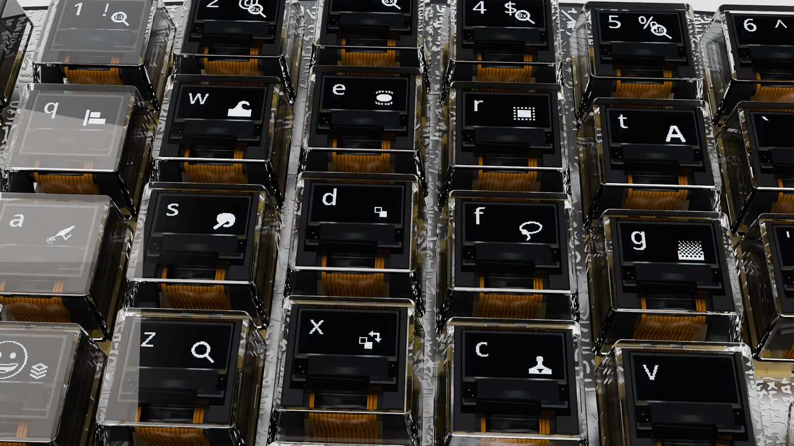

import { Aside, Steps } from '@astrojs/starlight/components';

The main PolyKybd feature: every key's OLED shows an image ("overlay") that matches
**the app you are currently using**. Switch from your browser to your editor and all 72
keycaps re-label themselves to that app's shortcuts, with no action from you.

Overlays are driven by [PolyKybdHost](/software/overview/) — the keyboard on its own shows the
static legends built into the firmware; the host is what makes them dynamic.

## How it works

1. PolyKybdHost watches which window is focused on your computer.
2. When the active app changes, it sends that app's keycap images to the keyboard over USB,
   and both halves update.

## Modifier variants

An overlay isn't a single image per key — each key stores **16 variants**, one for every
combination of Ctrl, Shift, Alt and GUI (Command on macOS, Win elsewhere). Hold a modifier and
the keycaps update to show what each key does *with that modifier down*, so a shortcut layer is
visible before you press a key.

## What you need

- **PolyKybdHost running** on the machine you're typing on (or relayed from another machine —
  see [Multi-Machine Setup](/using/multi-machine/)).
- An overlay set for the app. PolyKybdHost ships overlays for the apps listed
  [below](#which-apps-are-covered), and adding one is a plain image plus a one-line mapping
  entry — [Create App Overlays](/howto/app-overlays/) explains the steps.

## Which apps are covered

These ship with PolyKybdHost and work as soon as it is running. Nothing to install or
configure.

Every app has a default set, drawn with `Ctrl` shortcuts. A ✓ under macOS or Linux means
the app also has its own set for that platform, which the host picks there instead (see
[Same app, different platform](#same-app-different-platform)). An empty cell means that
platform gets the default set, if the app runs there at all.

| | App | macOS | Linux | Notes |
| --- | --- | :---: | :---: | --- |
| **Browsers** | Chrome, Chromium, Edge, Brave, Vivaldi, Opera, Arc | ✓ | | |
| | Firefox | ✓ | ✓ | |
| | qutebrowser | | | One set on every platform, because qutebrowser uses Ctrl on macOS too. The web-app sets below are not used in it |
| | Safari | ✓ | | macOS only, so its one set is drawn for macOS (Command). The web apps below load in Safari too |
| **Web apps** | GitHub | ✓ | | Matched by the tab's URL, in any browser above. See [Website-Aware Overlays](/using/website-detection/) |
| | GitLab | ✓ | | |
| | Jira | ✓ | | |
| | Confluence | ✓ | | Whiteboards get their own set |
| | Bitbucket | ✓ | | |
| | Google Docs | ✓ | | |
| | Miro | ✓ | | |
| | Notion | ✓ | | |
| | Outlook on the web | ✓ | | |
| | Claude (claude.ai) | ✓ | | |
| | Claude Code on the web | ✓ | | |
| | ChatGPT | ✓ | | Codex in a tab gets the browser's set |
| | Gmail, Google Calendar, Sheets, Slides, Meet | | | |
| | Word, Excel, PowerPoint and OneNote on the web, Teams on the web, Microsoft Copilot | | | |
| | Figma, Trello, Linear, Overleaf, Jupyter, draw.io, Excalidraw | | | |
| | YouTube | | | The player keys |
| | Google Drive, Google Keep | ✓ | | Keep: only `keep.google.com`, not its help pages |
| | Canva | ✓ | | Only the design editor, not the home or help pages |
| | Photopea | ✓ | | Only the editor, not the learn and blog pages |
| | Todoist | ✓ | | Also the desktop app |
| | Monkeytype, keybr | ✓ | | The typing test pages only. On macOS keybr shows only Enter. In Firefox, Monkeytype's command line key (Ctrl+Shift+P) is left out, because Firefox uses it |
| **Office & documents** | Word, Excel, PowerPoint, Outlook | ✓ | | |
| | OneNote | ✓ | | |
| | Visio, Microsoft 365 Copilot, Microsoft Copilot | | | |
| | Acrobat | ✓ | | |
| | SumatraPDF, Okular | | | |
| | LibreOffice Writer, Calc, Impress | ✓ | | Identified by window title; Draw, Base and Math get a shared LibreOffice set |
| | WPS Office Writer, Spreadsheets, Presentation | | | Windows and Linux. In the all-in-one window, the set follows the file extension in the title |
| | ONLYOFFICE Document, Spreadsheet, Presentation | ✓ | | One window for all three: the set follows the file extension in the title. On macOS the tabbed main window gets the Document set |
| **Creative** | Photoshop, Illustrator, After Effects, Premiere Pro | ✓ | | |
| | DaVinci Resolve | ✓ | | |
| | GIMP, Krita | ✓ | | |
| | Inkscape | | | |
| | Figma | ✓ | | |
| | Lightroom Classic, InDesign | ✓ | | |
| | Affinity, Affinity Designer, Photo, Publisher | ✓ | | |
| | FreeCAD, OpenSCAD | ✓ | ✓ | |
| | Autodesk Fusion | ✓ | | |
| | [Blender](#blender-overlays-that-follow-the-mode) | ✓ | | 14 sets that follow the mode, with the add-on |
| | AutoCAD, Clip Studio Paint | ✓ | | Windows and macOS |
| | CapCut | ✓ | | Windows and macOS |
| | Autodesk Maya, Cinema 4D, SideFX Houdini, Foundry Nuke, Adobe Substance 3D Painter | ✓ | | |
| | SketchUp Pro | ✓ | | Windows and macOS |
| | Autodesk 3ds Max, Autodesk Inventor | | | Windows only |
| | OBS Studio | ✓ | ✓ | |
| **Audio & music** | Ableton Live, FL Studio, REAPER | ✓ | | |
| | MuseScore, Audacity | ✓ | ✓ | |
| | Spotify, VLC | ✓ | | |
| | foobar2000, Winamp | | | Windows only |
| | Avid Pro Tools | ✓ | | Windows and macOS. The keys without a modifier work only while Commands Keyboard Focus is on |
| | Steinberg Cubase, Bitwig Studio, Ardour, LMMS | ✓ | | Cubase: Windows and macOS |
| | Logic Pro, GarageBand | ✓ | | macOS only, so their one set is drawn for macOS (Command) |
| **3D printing** | PrusaSlicer (and its G-code viewer), OrcaSlicer | ✓ | | |
| | Bambu Studio | ✓ | ✓ | |
| **Engineering & science** | QGIS, LabVIEW, COMSOL Multiphysics | ✓ | ✓ | |
| | Simulink | ✓ | | Chosen by the Simulink Editor's window title. The other MATLAB windows keep the MATLAB set |
| | PTC Mathcad Prime, OriginPro, Tekla Structures | | | Windows only |
| | Altium Designer | | | Windows only. The PCB Editor set; a window whose title names a schematic document (`.SchDoc`, `.SchLib`) gets the Schematic Editor set |
| | OrCAD X Capture | | | Windows only. The schematic page editor |
| **ArtCraft** | PhotoCraft, VectorCraft, DesignCraft, FigCraft, LightCraft, EffectCraft, FilmCraft, SoundCraft, DeckCraft, WordCraft, GridCraft, PDFCraft, CADCraft, AniCraft, TextureCraft, MaterialCraft | ✓ | | |
| **Development** | VS Code | ✓ | ✓ | |
| | Visual Studio | | | |
| | JetBrains IDEs: IntelliJ IDEA, PyCharm, CLion, WebStorm, GoLand, Rider, PhpStorm, RubyMine, DataGrip, RustRover, Android Studio | ✓ | ✓ | Linux has separate GNOME and KDE sets |
| | Sublime Text | ✓ | ✓ | |
| | Notepad++ | | | |
| | KiCad | ✓ | | PCB editor, schematic, symbol and footprint editors, 3D viewer and Gerber viewer, identified by window title. The macOS set is for the PCB editor |
| | Eclipse, Arduino IDE 2 | ✓ | ✓ | |
| | STM32CubeIDE | ✓ | ✓ | The Eclipse set with the C/C++ editor keys |
| | IAR Embedded Workbench for Arm | | ✓ | On Linux only if the IDE's process is named `iaridepm` |
| | IDA Pro, Binary Ninja | ✓ | | |
| | Ghidra, Wireshark, Postman, GitHub Desktop | ✓ | | Ghidra: the CodeBrowser window |
| | DBeaver | ✓ | ✓ | |
| | RStudio, MATLAB | ✓ | | |
| | Mathematica | ✓ | ✓ | |
| | [Vim, Neovim, Emacs, GNU nano](#vim-emacs-and-nano-overlays-that-follow-the-mode) | | | In a terminal, and GUI Vim and Emacs. A set per mode, with the plugin |
| | Cursor, Windsurf / Devin Desktop, Zed | ✓ | ✓ | |
| | GitKraken | ✓ | | |
| | Sourcetree | ✓ | | Windows and macOS |
| | SQL Server Management Studio | | | Windows only |
| **Notes** | Obsidian, Notion desktop app | ✓ | | |
| | Joplin, Logseq | ✓ | | |
| | Evernote | ✓ | | Windows and macOS |
| **Communication** | Slack, Discord, Teams, Zoom | ✓ | | |
| | Webex, Webex Meetings | ✓ | | |
| | Thunderbird | ✓ | ✓ | The compose window has its own set |
| | Telegram Desktop | ✓ | | On macOS only the app named *Telegram Desktop*; the Mac App Store app named *Telegram* has other keys and keeps the generic icons |
| | Signal Desktop | ✓ | ✓ | |
| **Passwords** | KeePassXC | ✓ | ✓ | |
| | KeePass 2 | | ✓ | Windows, and Linux with Mono |
| **AI assistants** | Claude desktop app | ✓ | | Shows the Code tab's shortcuts in both tabs, which share one window |
| | ChatGPT desktop app, Codex desktop app | ✓ | | |
| | LM Studio, Jan | ✓ | | |
| **Windows** | Explorer, Task Manager, Notepad, Calculator, Paint, Paint.NET, WordPad, Photos, Snipping Tool, the lock screen | | | Windows only |
| | Sticky Notes | | | |
| | Sound Recorder | | | Also matches its Windows 10 name, *Voice Recorder* |
| | Windows Terminal, 7-Zip | | | |
| | Everything, Total Commander | | | |
| | PowerToys Command Palette, PowerToys Run | | | Only those two windows; the other PowerToys features are global shortcuts |
| **Linux** | GNOME Files (Nautilus) | | | Linux only |
| **Terminals & transfer** | PuTTY, WinSCP | | | |
| | kitty, WezTerm | ✓ | | The terminal's own keys. A [terminal program](#terminal-programs) named in the title takes priority |
| | tmux, Zellij | | | The multiplexer's keys, chosen by the terminal title |
| **Terminal programs** | Claude Code, Codex CLI, Gemini CLI, GitHub Copilot CLI, Grok Build, Kimi Code CLI, Mistral Vibe, OpenCode, Qwen Code, Aider | | | Found by the terminal title. See [Terminal programs](#terminal-programs) |
| | GDB | | | Two sets: one at the `(gdb)` prompt and one while the program runs, with the GDB script |
| | Helix, micro, less | | | |
| | htop, btop, k9s | | | |
| | Midnight Commander, lf, ranger, yazi, lazygit | | | |
| **Games** | Age of Empires II: HD Edition and the CD version | | | Default hotkeys: go-to-building keys, control groups, chat, function keys |
| | Age of Empires II: Definitive Edition | | | The same keys, its own Esc mark. Windows and Steam with Proton |
| | Age of Empires IV | | | Default Grid Keys |
| | Command & Conquer Remastered Collection | | | Keys drawn from your own Tiberian Dawn files when they are installed |
| | OpenRA: Red Alert, Tiberian Dawn, Dune 2000 | | | Keys drawn from the game files OpenRA installed |
| | Dune II (the DOS game and OpenDUNE), Dune Legacy | | | Keys drawn from your own `DUNE.PAK` |
| | StarCraft II | | | Control groups, F1 and Backspace are drawn from your own StarCraft 1.16.1 files when they are installed |
| | Civilization II, Civilization IV (also Warlords and Beyond the Sword), Freeciv, Freeciv21 | | | |
| | Minecraft: Java Edition and Bedrock Edition | ✓ | ✓ | |
| | Warzone 2100, 0 A.D., fheroes2, DevilutionX | | | |
| | Warcraft III (classic 1.26 to 1.31), Wargus | | | |
| | RimWorld, OpenTTD, OpenRCT2 | | | |
| | Factorio | ✓ | | |
| | League of Legends | | | The in-game window, Click-to-Move defaults. Ability keys stay blank because they depend on the champion. Windows and macOS |
| | Steam client | | | A separate set for Big Picture mode, chosen by the English window title |
| | Counter-Strike 2, Dota 2 | | | Windows and Linux. The Esc key shows the game logo in place of its legend |
| **Emulators** | RetroArch | | | The default hotkeys and the RetroPad keys of player 1 |
| | MAME | | | The default UI keys and the player 1 inputs |
| | VICE (all Commodore emulators) | ✓ | | Alt shortcuts, Command on macOS. The C64 and VIC-20 emulators also switch the keycaps to the [Commodore 64 keycap lettering](/using/glyph-scripts/#per-application) |
| | FS-UAE | ✓ | | Switches the keycaps to the [Amiga lettering](/using/glyph-scripts/#per-application) |
| | WinUAE, Amiberry | | | Both switch the keycaps to the Amiga lettering. WinUAE runs on Windows only |

Notion, Claude and ChatGPT appear twice because the desktop app and the web version are
matched separately.

Google Drive, KeePassXC and KeePass 2 need PolyKybdHost 1.18.0. Canva, Photopea, Todoist,
Google Keep, WPS Office, Telegram, Signal, League of Legends and Steam need PolyKybdHost
1.19.11. ONLYOFFICE, AutoCAD, Clip Studio Paint, CapCut, OBS Studio, foobar2000, Winamp,
GitKraken, Sourcetree, SQL Server Management Studio, Joplin, Logseq, Evernote, Everything,
Total Commander, PowerToys, Counter-Strike 2 and Dota 2 need PolyKybdHost 1.19.40.
Minecraft, StarCraft II and Warzone 2100 need PolyKybdHost 1.17.86. Civilization II and IV,
Freeciv and the Dune sets need 1.18.0; fheroes2, DevilutionX
and 0 A.D. need 1.19.11. qutebrowser, Monkeytype, keybr, IDA Pro, Binary Ninja, STM32CubeIDE,
IAR Embedded Workbench, Altium Designer, OrCAD X Capture, LabVIEW, COMSOL, Simulink, OriginPro,
Tekla Structures, SketchUp, Inventor, 3ds Max, Cinema 4D, Nuke and Substance 3D Painter need
PolyKybdHost 1.19.58. Maya, Houdini, QGIS, Mathcad Prime and Pro Tools need 1.21.0. Cubase,
Bitwig Studio, Ardour, LMMS, Logic Pro, GarageBand, AniCraft, TextureCraft and MaterialCraft
need 1.22.16.

In Age of Empires II the letter keys build, train and give orders, and their meaning changes with
the selection, so only keys that always do the same thing have icons. Each digit shows a different
unit as a group (spearmen on 1, archers on 2, cavalry on 3 and so on): the bare digit selects the
group, and with Ctrl, where the icon has a plus, it creates it. The game does not tie a group
number to a unit type; the icons only suggest a habit. The Esc mark is drawn without the key legend
from firmware 1.9.15; the control groups and the Definitive Edition set need PolyKybdHost 1.17.82.

Claude Code, Codex CLI, Gemini CLI, GitHub Copilot CLI, OpenCode, Qwen Code and Aider need
**PolyKybdHost 1.19.11**. The other terminal programs, kitty, WezTerm, tmux and Zellij need
**PolyKybdHost 1.19.58**. GDB's second set, for a running program, needs **PolyKybdHost 1.20.0**. The emulators need **PolyKybdHost 1.20.0**. Their keycap lettering needs firmware 1.10.2 to sit
in the top-left corner; older firmware draws it centred.

Firefox, Blender, the ArtCraft apps, Cursor, Windsurf, Zed, LM Studio and Jan need
**PolyKybdHost 1.17.18 or later**. The games, the three slicers, Eclipse, Arduino IDE 2, Ghidra,
Wireshark, Trello, Figma on the web, YouTube, Vim, Emacs and nano need **PolyKybdHost 1.17.82 or
later**.

<Aside type="note">
This is what ships today. The authoritative list is `overlay-mapping.poly.yaml` in
PolyKybdHost. Adding an app yourself is a template image plus one mapping entry.
</Aside>

<Aside type="tip">
**An app that is not listed no longer shows blank keys.** PolyKybd collects what it can by
itself: the app's own icon on Escape, and an icon on each shortcut the app publishes. See
[Apps With No Overlay](/using/generic-overlays/).
</Aside>

<Aside type="note">
The icons for the operating system's own shortcuts, such as Win+L or Cmd+Tab, are not part of an
app overlay. The firmware draws them for every app. See [Shortcut Hints](/using/shortcut-hints/).
</Aside>

## Blender: overlays that follow the mode

Blender's shortcuts depend on the mode you are in and on the editor under the mouse. `Ctrl+R`
is Loop Cut in Edit Mode, Sculpt Mode has its own brush keys, and the Node Editor binds a
different set again. With the **PolyKybd Context Reporter** add-on, the keycaps change with the mode:
there are 14 shortcut sets, from Object and Edit Mesh to Sculpt, Pose, the paint modes, Node,
UV, Dope Sheet and Graph Editor.

Without the add-on, Blender still gets an overlay, but only with the keys every 3D View mode
shares.

<Steps>

1. **Build the add-on.** In a PolyKybdHost checkout, run `./build.sh` in the `blender-addon/`
   folder. It writes `dist/polykybd_context_reporter-<version>.zip`.

2. **Install it in Blender 4.2 or later.** Open *Edit → Preferences → Get Extensions*, then the
   drop-down at the top right, *Install from Disk…*, and pick the zip. On Blender 3.6–4.1, use
   *Edit → Preferences → Add-ons → Install…* and tick *PolyKybd Context Reporter*. That older
   path is untested.

3. **Keep PolyKybdHost running.** The add-on reports to the same local receiver as the
   [browser extension](/using/website-detection/), which is on by default. Nothing else needs
   configuring.

</Steps>

The add-on sends only the mode and the editor name, and only to `127.0.0.1` on this computer.
It sends no file names, object or scene data, and no window title. The host uses a report only
while Blender is the focused app, so a Blender in the background never changes the keycaps of
the app in front. You can pause reporting in the add-on's preferences without uninstalling it.

<Aside type="note">
If you set a `browser_report_token` in PolyKybdHost, enter the same value as *Token* in the
add-on's preferences. The default port, 50164, matches the host's default.
</Aside>

## Vim, Emacs and nano: overlays that follow the mode

In Vim the same key does different things in Normal, Insert and Visual mode, and Emacs binds
different keys in an Org or a Dired buffer. With a small plugin the editor reports its mode, and
the keycaps change with it. This also works when the editor runs in a terminal: while the
terminal is the focused app, the host shows the mode of the editor you last typed in.

- **Vim and Neovim** get a set per mode: Normal, Insert, Visual, Select, Replace, the command line
  and the terminal. The plugin is in `vim-plugin/` in a PolyKybdHost checkout. Copy it to
  `~/.vim/pack/polykybd/start/polykybd` (Vim) or load it with your plugin manager. It needs
  Vim 8.2.3430 or later, or Neovim 0.7 or later.
- **Emacs** gets a global set and its own sets for Org and Dired buffers. The package is in
  `emacs-package/`. On Emacs 29 or later, install it with `package-vc-install` and turn it on
  with `(polykybd-mode 1)`. Its README lists the other ways.
- **GNU nano** has no plugin. The host finds it by the terminal's window title, like the other
  [terminal programs](#terminal-programs).

*Updates → Set up the terminal and editors…* in the tray copies the Vim and Neovim plugin and the
Emacs package for you. `polyctl editor-plugins install` does the same for every editor it finds,
including GDB; repeat `--editor vim`, `--editor emacs` and so on to choose.

Without a plugin, a terminal shows its own overlay or the shortcuts the host finds for it. The
plugins send the editor's name, its mode, whether it has the focus, its process ID and the time
since the last keypress, and only to `127.0.0.1` on this computer.

<Aside type="caution">
A terminal tells the editor that it lost the focus through focus events. In **tmux**, turn them on
with `set -g focus-events on` in `~/.tmux.conf`, or the editor keeps reporting while you work in
another tab. An editor in an SSH session runs on the other computer, so its reports go to that
computer's `127.0.0.1` and do not reach the host.
</Aside>

## Terminal programs

The host sees only the terminal window, not the program running in it. It finds the program by
the terminal's **window title**, so the program's name must be in the title.

While a program's set is shown, the keys the program does not use keep the terminal's own
shortcuts, such as new tab, copy and paste, because the terminal reads those keys first. They are
[drawn dimmed](/using/website-detection/#browser-keys-are-drawn-dimmed), as a browser's are under
a website, and the program's keys stay at full strength. This needs PolyKybdHost 1.19.40.

- **Programs that write their own title** need no setup: Claude Code, Gemini CLI, GitHub Copilot
  CLI, Grok Build, Kimi Code CLI, Mistral Vibe, OpenCode, Qwen Code, Midnight Commander and
  Zellij.
- **The other programs write no title**, so the shell must put the running command there. fish,
  Nushell, xonsh, cmd.exe and zsh with oh-my-zsh do this already. For bash, zsh and PowerShell,
  use *Updates → Set up the terminal and editors…* in the tray, or
  `polyctl shell-integration install`. Open a new terminal window afterwards.
- **Codex CLI** writes a title that does not name it. Tick *Also show Codex in the title* in the
  same dialog (`polyctl shell-integration install --codex`), and the shell wraps the `codex`
  command so that its title names Codex.
- **GDB** gets one set at the `(gdb)` prompt and another, with only Ctrl+C, while the program runs.
  For that, tick GDB in the same dialog, or run `polyctl editor-plugins install --editor gdb`.
  The GDB script then writes GDB's state into the title. It needs GDB 8.0 or later built with
  Python, and is tested on Linux only. Without the script, GDB writes no title, so it needs the shell setup above and shows
  the prompt set in both states.

A Kimi Code session that has a title, and a named Qwen Code session while it waits for input, show
only the session name in the title, so their sets are not shown then.

<Aside type="caution">
In **tmux**, the terminal keeps the title tmux had when it started, and the tmux set is shown. Add
`set -g set-titles on` and `set -g set-titles-string '#T'` to `~/.tmux.conf` to pass the
program's title on. In **Windows Terminal**, keep the profile setting *Suppress title changes*
off (the default). A program in an editor's built-in terminal, such as the one in VS Code, is not
found: the focused window is then the editor.
</Aside>

## Same app, different platform

Which shortcuts an app uses depends on the platform it runs on: Sublime Text binds `Cmd+P` on
macOS and `Ctrl+P` on Windows and Linux. A single set of artwork therefore can't be right
everywhere, so where an app has per-OS overlays the host picks the one matching your OS —
`Cmd` artwork on macOS, `Ctrl` artwork elsewhere — with nothing to configure.

<Aside type="tip">
This follows the machine the **app** runs on, not the one your keyboard is plugged into. If you
use the keyboard with a Mac over a [multi-machine setup](/using/multi-machine/), you still get
the Mac artwork.
</Aside>

<Aside type="tip">
Browsers are a special case: many web apps share one browser process, so matching on the app
name alone isn't enough. [Website-Aware Overlays](/using/website-detection/) match the overlay
to the focused tab's **URL** instead, so Jira, GitHub and Miro each get their own layer. The
website's layer sits [on top of the browser's](/using/website-detection/#the-browsers-shortcuts-stay-underneath),
so the browser's own shortcuts stay on the keys the website doesn't use.
</Aside>

<Aside type="note">
For the technical details (the exact HID commands, the compression path, and how both
halves stay in sync), see [System Model & Data Flow](/development/system-model/#overlay-data-path--an-app-switch)
and the [HID Protocol Reference](/reference/hid-protocol/#overlay-addressing).
</Aside>
