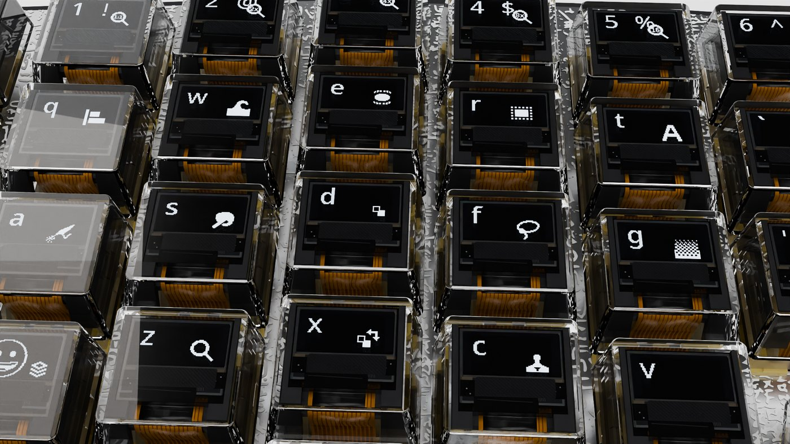

import { Aside, Steps } from '@astrojs/starlight/components';

The signature PolyKybd feature: every key's OLED shows an image ("overlay") that matches
**whatever app you're currently in**. Switch from your browser to your editor and all 72
keycaps re-label themselves to that app's shortcuts, with no action from you.

Overlays are driven by [PolyKybdHost](/software/overview/) — the keyboard on its own shows the
static legends baked into the firmware; the host is what makes them dynamic.

## How it works

1. PolyKybdHost watches which window is focused on your computer.
2. When the active app changes, it sends that app's keycap images to the keyboard over USB,
   and both halves update.

## Modifier variants

An overlay isn't a single image per key — each key stores **16 variants**, one for every
combination of Ctrl, Shift, Alt and GUI (Command on macOS, Win elsewhere). Hold a modifier and
the keycaps update to show what each key does *with that modifier down*, so a shortcut layer is
visible before you commit to it.

## What you need

- **PolyKybdHost running** on the machine you're typing on (or relayed from another machine —
  see [Multi-Machine Setup](/using/multi-machine/)).
- An overlay set for the app. PolyKybdHost ships overlays for the apps listed
  [below](#which-apps-are-covered), and adding one is a plain image plus a one-line mapping
  entry — [Create App Overlays](/howto/app-overlays/) walks through it.

## Which apps are covered

These ship with PolyKybdHost and work as soon as it is running. Nothing to install or
configure.

Every app has a default set, drawn with `Ctrl` shortcuts. A ✓ under macOS or Linux means
the app also has its own set for that platform, which the host picks there instead (see
[Same app, different platform](#same-app-different-platform)). An empty cell means that
platform gets the default set, if the app runs there at all.

| | App | macOS | Linux | Notes |
| --- | --- | :---: | :---: | --- |
| **Browsers** | Chrome, Chromium, Edge, Brave, Vivaldi, Opera, Arc | ✓ | | |
| | Firefox | ✓ | ✓ | |
| **Web apps** | GitHub | ✓ | | Matched by the tab's URL, in any browser above. See [Website-Aware Overlays](/using/website-detection/) |
| | GitLab | ✓ | | |
| | Jira | ✓ | | |
| | Confluence | ✓ | | Whiteboards get their own set |
| | Bitbucket | ✓ | | |
| | Google Docs | ✓ | | |
| | Miro | ✓ | | |
| | Notion | ✓ | | |
| | Outlook on the web | ✓ | | |
| | Claude (claude.ai) | ✓ | | |
| | Claude Code on the web | ✓ | | |
| | ChatGPT | ✓ | | Codex in a tab gets the browser's set |
| **Office & documents** | Word, Excel, PowerPoint, Outlook | ✓ | | |
| | LibreOffice Writer, Calc, Impress | ✓ | | Told apart by window title; Draw, Base and Math get a shared LibreOffice set |
| **Creative** | Photoshop, Illustrator, After Effects, Premiere Pro | ✓ | | |
| | DaVinci Resolve | ✓ | | |
| | GIMP, Krita | ✓ | | |
| | Inkscape | | | |
| | Figma | ✓ | | |
| | [Blender](#blender-overlays-that-follow-the-mode) | ✓ | | 14 sets that follow the mode, with the add-on |
| **ArtCraft** | PhotoCraft, VectorCraft, DesignCraft, FigCraft, LightCraft, EffectCraft, FilmCraft, SoundCraft, DeckCraft, WordCraft, GridCraft, PDFCraft, CADCraft | ✓ | | |
| **Development** | VS Code | ✓ | ✓ | |
| | Visual Studio | | | |
| | JetBrains IDEs: IntelliJ IDEA, PyCharm, CLion, WebStorm, GoLand, Rider, PhpStorm, RubyMine, DataGrip, RustRover, Android Studio | ✓ | ✓ | Linux has separate GNOME and KDE sets |
| | Sublime Text | ✓ | ✓ | |
| | Notepad++ | | | |
| | KiCad | | | PCB Editor window only |
| | Cursor, Windsurf / Devin Desktop, Zed | ✓ | ✓ | |
| **Notes** | Obsidian, Notion desktop app | ✓ | | |
| **Communication** | Slack, Discord, Teams, Zoom | ✓ | | |
| **AI assistants** | Claude desktop app | ✓ | | Shows the Code tab's shortcuts in both tabs, which share one window |
| | ChatGPT desktop app, Codex desktop app | ✓ | | |
| | LM Studio, Jan | ✓ | | |
| **Windows** | Explorer, Task Manager, Notepad, Calculator, Paint, Paint.NET, WordPad, Photos, Snipping Tool, the lock screen | | | Windows only |
| | Sticky Notes | | | |
| | Sound Recorder | | | Also matches its Windows 10 name, *Voice Recorder* |
| | Windows Terminal, 7-Zip | | | |
| **Linux** | GNOME Files (Nautilus) | | | Linux only |
| **Terminals & transfer** | PuTTY, WinSCP | | | |

Notion, Claude and ChatGPT appear twice because the desktop app and the web version are
matched separately.

Firefox, Blender, the ArtCraft apps, Cursor, Windsurf, Zed, LM Studio and Jan need
**PolyKybdHost 1.17.18 or later**.

<Aside type="note">
This is what ships today. The authoritative list is `overlay-mapping.poly.yaml` in
PolyKybdHost. Adding an app yourself is a template image plus one mapping entry.
</Aside>

<Aside type="tip">
**An app that isn't listed is no longer a blank.** PolyKybd works out what it can on its
own: the app's own icon on Escape, and an icon on each shortcut the app advertises. See
[Apps With No Overlay](/using/generic-overlays/).
</Aside>

<Aside type="note">
The icons for the operating system's own chords, such as Win+L or Cmd+Tab, are not part of an
app overlay. The firmware draws them for every app. See [Shortcut Hints](/using/shortcut-hints/).
</Aside>

## Blender: overlays that follow the mode

Blender's shortcuts depend on the mode you are in and on the editor under the mouse. `Ctrl+R`
is Loop Cut in Edit Mode, Sculpt Mode has its own brush keys, and the Node Editor binds a
different set again. With the **PolyKybd Context Reporter** add-on, the keycaps follow along:
there are 14 shortcut sets, from Object and Edit Mesh to Sculpt, Pose, the paint modes, Node,
UV, Dope Sheet and Graph Editor.

Without the add-on, Blender still gets an overlay, but only with the keys every 3D View mode
shares.

<Steps>

1. **Build the add-on.** In a PolyKybdHost checkout, run `./build.sh` in the `blender-addon/`
   folder. It writes `dist/polykybd_context_reporter-<version>.zip`.

2. **Install it in Blender 4.2 or later.** Open *Edit → Preferences → Get Extensions*, then the
   drop-down at the top right, *Install from Disk…*, and pick the zip. On Blender 3.6–4.1, use
   *Edit → Preferences → Add-ons → Install…* and tick *PolyKybd Context Reporter*. That older
   path is untested.

3. **Keep PolyKybdHost running.** The add-on reports to the same local receiver as the
   [browser extension](/using/website-detection/), which is on by default. Nothing else needs
   configuring.

</Steps>

The add-on sends only the mode and the editor name, and only to `127.0.0.1` on this computer.
It sends no file names, object or scene data, and no window title. The host uses a report only
while Blender is the focused app, so a Blender in the background never changes the keycaps of
the app in front. You can pause reporting in the add-on's preferences without uninstalling it.

<Aside type="note">
If you set a `browser_report_token` in PolyKybdHost, enter the same value as *Token* in the
add-on's preferences. The default port, 50164, matches the host's default.
</Aside>

## Same app, different platform

Which shortcuts an app uses depends on the platform it runs on: Sublime Text binds `Cmd+P` on
macOS and `Ctrl+P` on Windows and Linux. A single set of artwork therefore can't be right
everywhere, so where an app has per-OS overlays the host picks the one matching your OS —
`Cmd` artwork on macOS, `Ctrl` artwork elsewhere — with nothing to configure.

<Aside type="tip">
This follows the machine the **app** runs on, not the one your keyboard is plugged into. If you
drive the keyboard from a Mac over a [multi-machine setup](/using/multi-machine/), you still get
the Mac artwork.
</Aside>

<Aside type="tip">
Browsers are a special case: many web apps share one browser process, so matching on the app
name alone isn't enough. [Website-Aware Overlays](/using/website-detection/) match the overlay
to the focused tab's **URL** instead, so Jira, GitHub and Miro each get their own layer. The
website's layer sits [on top of the browser's](/using/website-detection/#the-browsers-shortcuts-stay-underneath),
so the browser's own shortcuts stay on the keys the website doesn't use.
</Aside>

<Aside type="note">
Want the technical version — the exact HID commands, the compression path, and how both
halves stay in sync? See [System Model & Data Flow](/development/system-model/#overlay-data-path--an-app-switch)
and the [HID Protocol Reference](/reference/hid-protocol/#overlay-addressing).
</Aside>
