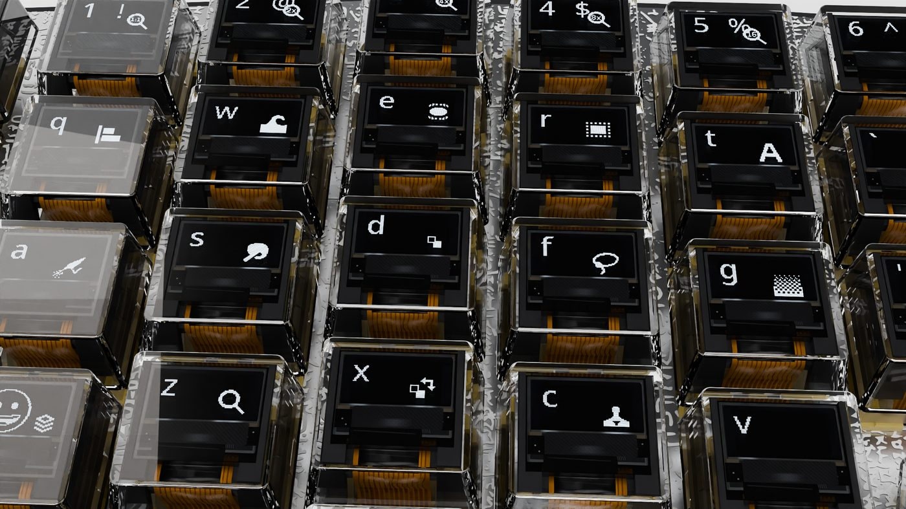

import { Aside } from '@astrojs/starlight/components';

The main PolyKybd feature: every key's OLED shows an image ("overlay") that matches
**the app you are currently using**. Switch from your browser to your editor and all 72
keycaps re-label themselves to that app's shortcuts, with no action from you.

Overlays are driven by [PolyKybdHost](/software/overview/) — the keyboard on its own shows the
static legends built into the firmware; the host is what makes them dynamic.

## How it works

1. PolyKybdHost watches which window is focused on your computer.
2. When the active app changes, it sends that app's keycap images to the keyboard over USB,
   and both halves update.

## Modifier variants

An overlay isn't a single image per key — each key stores **16 variants**, one for every
combination of Ctrl, Shift, Alt and GUI (Command on macOS, Win elsewhere). Hold a modifier and
the keycaps update to show what each key does *with that modifier down*, so a shortcut layer is
visible before you press a key.

## What you need

- **PolyKybdHost running** on the machine you're typing on (or relayed from another machine —
  see [Multi-Machine Setup](/using/multi-machine/)).
- An overlay set for the app. PolyKybdHost ships overlays for the apps listed
  [below](/using/overlays/supported-apps/#which-apps-are-covered), and adding one is a plain image plus a one-line mapping
  entry — [Create App Overlays](/howto/app-overlays/) explains the steps.

## Same app, different platform

Which shortcuts an app uses depends on the platform it runs on: Sublime Text binds `Cmd+P` on
macOS and `Ctrl+P` on Windows and Linux. A single set of artwork therefore can't be right
everywhere, so where an app has per-OS overlays the host picks the one matching your OS —
`Cmd` artwork on macOS, `Ctrl` artwork elsewhere — with nothing to configure.

<Aside type="tip">
This follows the machine the **app** runs on, not the one your keyboard is plugged into. If you
use the keyboard with a Mac over a [multi-machine setup](/using/multi-machine/), you still get
the Mac artwork.
</Aside>

<Aside type="tip">
Browsers are a special case: many web apps share one browser process, so matching on the app
name alone isn't enough. [Website-Aware Overlays](/using/website-detection/) match the overlay
to the focused tab's **URL** instead, so Jira, GitHub and Miro each get their own layer. The
website's layer sits [on top of the browser's](/using/website-detection/#the-browsers-shortcuts-stay-underneath),
so the browser's own shortcuts stay on the keys the website doesn't use.
</Aside>

<Aside type="note">
For the technical details (the exact HID commands, the compression path, and how both
halves stay in sync), see [System Model & Data Flow](/development/system-model/#overlay-data-path--an-app-switch)
and the [HID Protocol Reference](/reference/hid-protocol/overlay-mapping/#overlay-addressing).
</Aside>

## More overlay pages

- [Supported Apps for Overlays](/using/overlays/supported-apps/): every app that has an overlay, by platform.
- [Overlays That Follow the Mode](/using/overlays/mode-aware-apps/): Blender, Vim, Emacs, nano and terminal programs.
